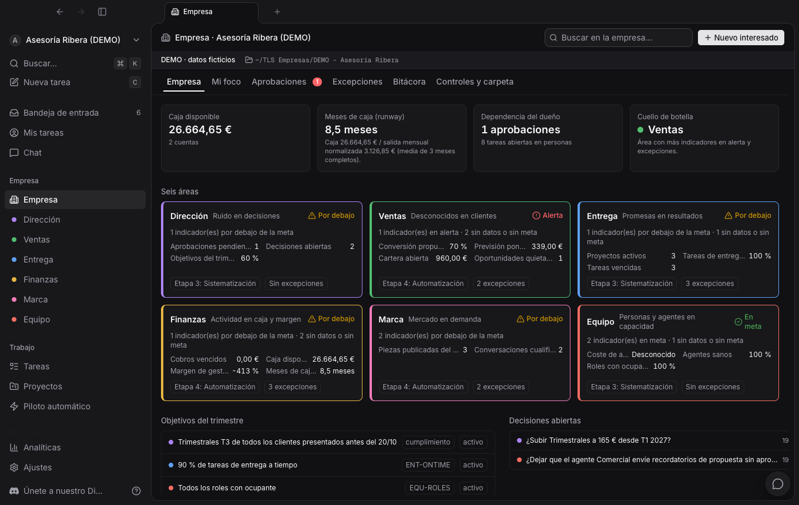
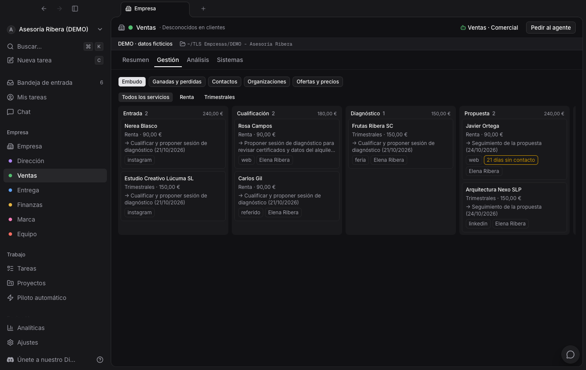
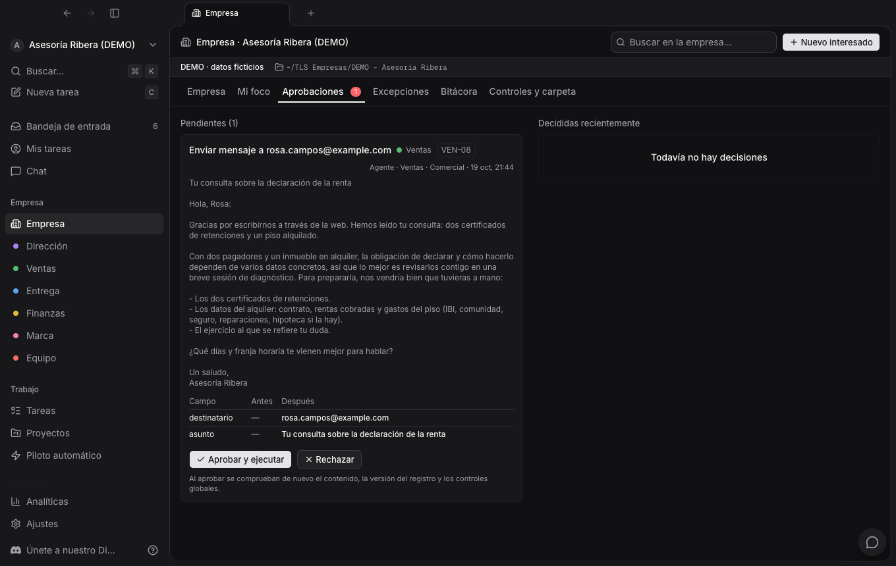
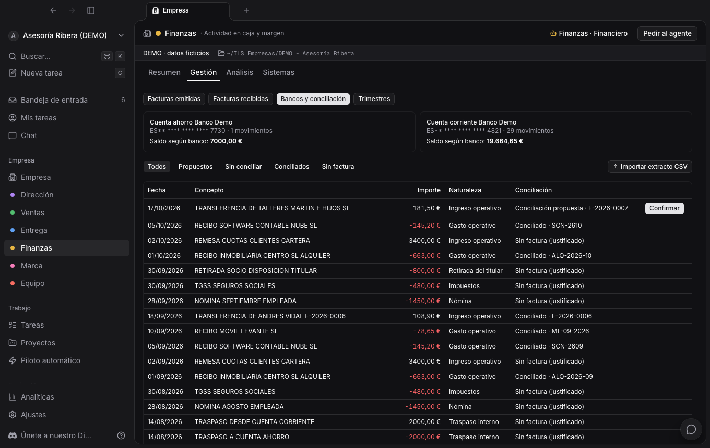

# Multica Business (TLS)

Sistema operativo de empresa para macOS: seis áreas de negocio, CRM, entrega por servicios, finanzas con conciliación y paquete trimestral, y agentes de IA que trabajan con aprobaciones, auditoría e interruptor global.

Construido sobre [Multica](https://github.com/multica-ai/multica) (fork de `e752b971b`). La interfaz, las tareas, los proyectos, los agentes y su runtime son los de Multica; TLS añade la capa de empresa y una app nativa de macOS.

> **Uso interno.** La versión 0.1 es una demostración funcional con una empresa ficticia: **Asesoría Ribera**, una gestoría con los servicios de Renta y Trimestrales. Ver [Licencia y atribución](#licencia-y-atribución).



## Qué hace

| Área | Qué incluye |
|---|---|
| **Dirección** | Objetivos con KPI, decisiones solo añadibles (porqué y para qué), rituales de día, semana, mes y trimestre, madurez por evidencias, interruptor global y modo lectura |
| **Ventas** | Alta en un paso (empresa + contacto + oportunidad, sin duplicados), embudo con reglas por etapa, propuesta con instantánea de precio, aceptación con evidencia, previsión ponderada, atribución |
| **Entrega** | Un **canvas** (tablero con las etapas del proceso) por servicio. El proyecto nace solo al confirmarse el cobro, con tareas de plantilla que tienen fecha de planificación y de vencimiento. Cierre con evidencia |
| **Finanzas** | Facturas (borrador → emitida, numeradas), cobros y pagos, importación de extractos CSV sin duplicados, conciliación propuesta y confirmada, caja y meses de caja, paquete trimestral para la gestoría |
| **Marca** | Contenidos con estados y evidencia de publicación, escucha → conversación → interesado con su origen |
| **Equipo** | Roles con misión, decisiones y límites; personas y agentes; salud, coste y presupuesto de cada agente |

**Agentes.** Uno por área, coordinados por el de Dirección. Actúan solo a través de la API con el CLI `multica biz`:
- **Aprobación:** las acciones sensibles (enviar, emitir, confirmar dinero, publicar) se convierten en una aprobación que muestra el antes y el después.
- **Modo por capacidad:** cada una de las 78 capacidades tiene su modo (manual, asistido, supervisado o autónomo).
- **Confinamiento:** cada ejecución corre en un sandbox de macOS, sin acceso a la carpeta de la empresa, a las credenciales ni a la base de datos.

**Datos portables.** Cada empresa tiene una carpeta legible (Markdown con frontmatter, CSV y PDF) que se escribe mediante un diario de recuperación. Se puede reconstruir la base de datos desde ella campo a campo.

| Ventas | Aprobaciones | Bancos y conciliación |
|---|---|---|
|  |  |  |

## Instalar (release)

Descarga desde **Releases**:

| Fichero | Para qué |
|---|---|
| `TLS-0.1.0.dmg` | Uso normal (configuración Release) |
| `TLS-0.1.0-debug.dmg` | Desarrollo: build Debug con el inspector web de Safari activado y ganchos de automatización (`apps/macos/scripts/debug-hook.sh`) |

Requisitos:
- Mac con **Apple Silicon** y **macOS 13 o posterior**.
- No hace falta instalar nada más: la app lleva dentro su base de datos (PostgreSQL 17), su servidor y la demo.
- Opcional, para que trabajen los agentes: tener [Claude Code](https://docs.anthropic.com/claude-code) instalado y con sesión iniciada (`claude`). Sin él, todo funciona salvo las ejecuciones de agentes.

Pasos:
1. Abre el `.dmg` y arrastra **TLS** a *Aplicaciones*.
2. **Primera apertura:** la app está firmada para desarrollo, pero no notarizada. macOS la bloqueará la primera vez. Hay dos formas de abrirla:
   - Ve a *Ajustes del Sistema → Privacidad y seguridad* y pulsa **Abrir igualmente** junto al aviso de TLS.
   - O, en Terminal: `xattr -dr com.apple.quarantine /Applications/TLS.app`.
3. Al arrancar, TLS prepara la base de datos, aplica las migraciones e inicia sesión solo (unos segundos la primera vez). Entras como **Elena Ribera**, la dueña de la demo.

Dónde guarda las cosas:

| Qué | Dónde |
|---|---|
| Datos y secretos | `~/Library/Application Support/TLS/` (base de datos, `secrets.env`, configuración) |
| Registros | `~/Library/Logs/TLS/` |
| Carpeta de la empresa | `~/TLS Empresas/DEMO - Asesoría Ribera/` |
| Daemon de agentes | `~/.multica/profiles/tls-embedded/` |

Para empezar de cero, cierra TLS y borra `~/Library/Application Support/TLS/runtime` y la carpeta de la demo. Se restaurarán en el siguiente arranque.

Cómo usarla: **[Guía de la demo](docs/tls/GUIA-DEMO.md)**.

## Arquitectura

```
TLS.app (Swift/AppKit, proyecto Xcode)
├─ WKWebView ── tls-app://app/   interfaz de Multica (React) servida desde el bundle
│   └─ bridge.js               desktopAPI / daemonAPI sobre un puente nativo cerrado
├─ LocalStack                  PostgreSQL embebido (solo socket Unix) → migraciones
│                              → servidor Go en 127.0.0.1:18080 → sesión local automática
├─ DaemonManager               daemon de agentes (`multica`) con perfil de sandbox
└─ Resources/                  renderer, bin/{multica, multica-server, multica-migrate},
                               postgres/, migrations/, demo/
Servidor Go (server/)          Multica + capa de empresa `internal/biz` (/api/biz)
```

## Desarrollo

Requisitos: Node 22+ (pnpm vía corepack), Go 1.26+, PostgreSQL 17 (Homebrew), Xcode 26, XcodeGen.

```bash
pnpm install
brew services start postgresql@17
cp .env.example .env    # APP_ENV=development, MULTICA_DEV_VERIFICATION_CODE, JWT_SECRET,
                        # CORS_ALLOWED_ORIGINS=...,tls-app://app, FF_PROJECT_WORKFLOWS_V1=true
scripts/tls/run-backend.sh                    # migraciones + servidor en :8080
node scripts/tls/seed-demo.mjs --reset        # demo (añade --offline para no lanzar agentes)

apps/macos/scripts/prepare-artifacts.sh       # renderer, binarios Go, PostgreSQL embebido
scripts/tls/build-demo-snapshot.sh            # congela la demo para el bundle
apps/macos/scripts/build.sh                   # .app Release firmada
scripts/tls/build-dmg.sh                      # TLS-<versión>.dmg y -debug.dmg
```

- La app en modo **externo** usa el servidor de desarrollo: `~/Library/Application Support/TLS/runtime-config.json` sin `"mode": "embedded"` y con `apiUrl` = `http://localhost:8080`.
- Pruebas:
  - Go: `cd server && go test ./internal/biz ./pkg/agent ./internal/handler` (con `DATABASE_URL`).
  - Frontend: `pnpm --filter @multica/views exec vitest run` y `pnpm --filter @multica/core exec vitest run`.
- Para seguir trayendo cambios de Multica: `git remote add upstream https://github.com/multica-ai/multica.git` y luego `git merge upstream/main`. La capa de empresa vive aislada en `server/internal/biz`, `packages/{core,views}/…/empresa|biz`, `apps/macos` y `scripts/tls`.

## Documentación

| Documento | Contenido |
|---|---|
| [docs/tls/GUIA-DEMO.md](docs/tls/GUIA-DEMO.md) | Cómo se trabaja con TLS: el viaje del cliente paso a paso, agentes y controles |
| [docs/tls/ESTADO.md](docs/tls/ESTADO.md) | Estado por fases, criterios de aceptación con evidencia, pruebas y limitaciones |
| [docs/tls/DECISIONES.md](docs/tls/DECISIONES.md) | Decisiones de diseño y su motivo |
| [docs/tls/FORMATOS.md](docs/tls/FORMATOS.md) | Extracto bancario CSV, carpeta de la empresa y paquete trimestral |
| [docs/tls/FASE-0.md](docs/tls/FASE-0.md) | Auditoría de Multica y prueba Xcode/WebKit |
| [apps/macos/README.md](apps/macos/README.md) | La app nativa |
| [README.multica.md](README.multica.md) | README original de Multica |

## Seguridad

- **Red:**
  - El servidor embebido solo escucha en `127.0.0.1`.
  - PostgreSQL no abre puertos de red: solo un socket dentro de `Application Support`.
- **Secretos:** la clave JWT y el código de acceso local son aleatorios por instalación y están en `secrets.env` (permisos 0600). Ese fichero no se pasa por el entorno del proceso.
- **Agentes confinados con `sandbox-exec`:** no pueden leer `~/TLS Empresas`, `~/.multica/profiles` ni `Application Support/TLS`, ni ficheros `.env`, ni conectar con PostgreSQL. Solo usan la API, que aplica políticas, aprobaciones y auditoría.

## Licencia y atribución

Este proyecto deriva de **Multica** © Index Labs (Hong Kong) Limited, distribuido bajo la [Multica License](LICENSE) (Apache 2.0 con condiciones adicionales) con su [NOTICE](NOTICE).
- Su uso aquí es **interno**: alojarlo para terceros o venderlo como producto requiere una licencia comercial del productor.
- La interfaz conserva el logo, el nombre y los avisos de Multica, como exige la licencia.
- PostgreSQL embebido: binarios de [zonky embedded-postgres-binaries](https://github.com/zonkyio/embedded-postgres-binaries), con licencia PostgreSQL.
