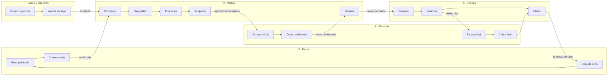
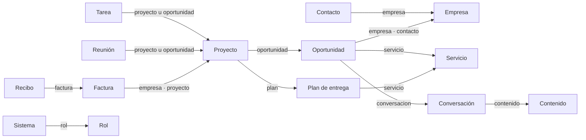

# Sistemas, estructura y flujos de The Last System (propuesta v2)

> **Qué es esto.** La propuesta completa de cómo se organiza una empresa dentro de la app, antes de empezar F1:
> la carpeta v2, los sistemas que toda empresa debe tener, cómo se conectan las áreas, qué ve cada persona
> o asistente, cómo se comporta la app con los ficheros (como Obsidian) y qué lleva cada asistente.
>
> **Estado:** propuesta para aprobar · 22/10/2026 · no cambia nada en tu carpeta.
>
> **Base:** PLAN.md (§2, §4, §5 y §6), la teoría TLB, los 25 sistemas de G3 (MANU-16), el estándar de 78
> funciones (`capacidades.yaml`), la demo «Asesoría Ribera», el método Kepano y los dos vídeos de referencia
> (ITK y Nico CMW), ya con su transcripción completa (análisis en `VIDEOS.md`; lo que aportan, en §9).
> De Blash solo se usan ideas, reescritas y marcadas «idea de Blash, reformulada».
> Los ejemplos son de Asesoría Ribera, una empresa ficticia. No hay datos de clientes reales.
>
> **Lo que no está aquí:** las 6 direcciones visuales para elegir van en su propio documento de diseño.
> Todo lo que sigue vale para cualquiera de ellas.

---

## 0. En una página

1. **La carpeta sigue organizada por áreas.** Del método Kepano se toma lo útil sin romper eso: la carpeta del
   área es el **hogar** de una ficha, las propiedades dicen a qué **pertenece**, cada colección tiene su
   **nota índice**, hay un **diccionario único de propiedades** y las **relaciones son enlaces legibles**
   dentro de las propiedades.
2. **19 sistemas en total:** el Buzón y 3 por área. Respeta la regla de TLB, «dos o tres por área; más es
   burocracia». Los 28 documentos de G3 (25 sistemas y 3 procedimientos) no se pierden: 17 pasan a ser
   fichas de sistema y 11 cuelgan de ellas como procedimientos. No se mueve ningún fichero y solo se proponen 3 cambios de nombre.
3. **El gobierno de cada área no es un sistema más.** Es su cabecera, `Área.md`, con el rol, la pregunta fija,
   la rutina y el número clave.
4. **De serie** (el primer día, en cualquier empresa) vienen 5 sistemas: Buzón, Decisiones, Revisión y
   replanificación, Rumbo y mapa, y Asistentes. El resto se instala por etapa, en el orden de TLB:
   Ventas → Entrega → Finanzas → Marca → Equipo → Dirección completa.
5. **Una ficha de sistema única** sirve a la vez de manual para la persona y de instrucciones para el
   asistente. Cada paso dice quién lo hace y en qué modo. Dicho sin jerga: **un sistema es una carpeta con el
   qué, el cómo, ejemplos y una forma de comprobarlo** (resumen nuestro del vídeo de Nico). Por eso la ficha
   lleva Entradas, Referencias y ejemplos, Herramientas y conexiones y la Salida esperada con su criterio de
   «bien hecho».
6. **Ciclo de vida de un sistema**, del vídeo de Nico y de TLB: se escribe a la tercera vez, el asistente
   replica un buen ejemplo antes de que le deleguemos nada, se prueba con un caso real y se itera, lo aprendido
   vuelve a la ficha como propuesta de mejora que apruebas tú, se mide y se poda.
7. **El recorrido del cliente** va de una conversación en Marca a un caso de éxito, pasando por Ventas,
   Finanzas y Entrega, con 23 eventos que conectan las áreas.
8. **Corrección al plan:** el contrato y la factura inicial nacen en **Aceptada**, no en Ganada. Ganada
   exige el cobro, así que esperar a Ganada dejaría sin factura que cobrar.
9. **Vistas por área y por función.** Cada área tiene sus pestañas. Además hay vistas para el empresario, un
   responsable de área, un colaborador, un asistente y el cliente (portal).
10. **Por dentro, la app se comporta como Obsidian:** renombrar o mover actualiza todos los enlaces, también
    los de las propiedades y los de los CSV. Lo mismo vale para los demás cambios en bloque. Todo se puede
    deshacer y nunca se borra nada.
11. **Módulos activables** como los plugins nativos de Obsidian. La barra lateral se personaliza con gestos de
    iPhone: mantener pulsado, arrastrar fuera para ocultar e indentar. Todo tiene también alternativa sin
    arrastrar.
12. **Hay 16 preguntas abiertas para ti, cada una con propuesta** (§7). Las 7 primeras bloquean el formato de
    F1. La 17, sobre los vídeos, queda resuelta.
13. **Lo que aportan los vídeos** (§9), ya aplicado en su sitio:
    - la ficha de cliente es el nodo central: enseña sola todo lo que la enlaza y crea reuniones, propuestas,
      proyectos y facturas ya enlazadas;
    - los nombres los pone la plantilla, y clientes y servicios tienen un ciclo de vida que acaba en archivar, no
      en borrar;
    - cada servicio tiene su reunión de descubrimiento con preguntas guía, y de sus notas el asistente saca el
      borrador de propuesta, que tú revisas y envías;
    - lo que en Obsidian exige plugins, TLS lo trae de serie.

---

## 1. Estructura de la carpeta v2

### 1.1 Principios (Kepano adaptado a carpetas por áreas)

| Práctica de Kepano | Cómo queda en TLS | Por qué |
|---|---|---|
| La categoría es una propiedad, no una carpeta | El **hogar** es la carpeta del área: dice quién responde de la ficha y lo decide la app según el tipo, no tú. La **pertenencia** va en propiedades: `tls_type`, `areas`, `relacion` | Nunca hay que pensar «dónde va» y se conservan tus áreas |
| Una nota de categoría por colección, con su vista incrustada | **Nota índice** con el mismo nombre que su carpeta (`Oportunidades/Oportunidades.md`), como ya hace G3. La app dibuja encima sus vistas, con pestañas por estado o por tipo (§1.4); para Obsidian, si lo activas, se incrusta `![[Oportunidades.base]]` | Se navega igual en la app y en Obsidian |
| Mismos nombres de propiedad en todos los tipos | **Diccionario único** en `.tls/propiedades.yaml` (§1.5): un nombre, un tipo, en toda la carpeta | Se acaban los sinónimos: `creada`, `created_at`, `entrada`… |
| Relaciones como enlaces dentro de propiedades | `empresa: "[[panaderia-sol\|Panadería Sol]]"`. La app guarda en su índice el `id` del destino para reparar enlaces (§1.6) | Se lee en texto plano y Obsidian lo entiende |
| Vistas reutilizables con `this` | Unas 14 vistas de serie que muestran «lo de esta ficha»: la ficha de cliente enseña sus oportunidades, reuniones, propuestas, proyectos y facturas (§4.4) | Pocas vistas que sirven en todas partes, no cientos a medida |
| Reuniones como fichas, con la fecha en el nombre | `Reuniones/AAAA-MM-DD-<slug>.md` dentro de lo que tratan: oportunidad, proyecto o área | Las actas tienen sitio fijo (hoy no lo tienen) |
| Una plantilla por tipo, propiedades arriba | Las plantillas viven **junto a su sistema** (`N · Área/Sistemas/Plantillas/`) | Responde a «sistemas con sus respectivas plantillas» |
| Enlaces a notas que aún no existen | Son «migas»: se ven en gris con «Crear», y la plantilla se elige por contexto | No es un error, es trabajo pendiente |
| Fechas `AAAA-MM-DD` en todas partes | En propiedades y en los nombres de eventos (reuniones, registros de rutina) | Se ordena solo y se lee igual en cualquier editor |
| Repasos | Rutina «Repaso de la carpeta» dentro del cierre de semana: 5 notas al azar y la salud de enlaces | «No delegar el entender»: los asistentes preparan, tú miras |

**Lo que no se toma de Kepano:** la carpeta casi vacía (tú quieres áreas), los nombres de fichero con título
humano (se mantiene el kebab ASCII, con `aliases` para el nombre bonito) y la lista de tareas semanal en un
solo fichero (se mantiene una ficha por tarea, que los asistentes necesitan; «Mi semana» es una vista).

### 1.2 Árbol completo

Leyenda: sin marca, existe en G3 · **+** nuevo, se crea la primera vez que hace falta · **~** cambia de nombre o de papel.

```
<Empresa>/
├── Empresa.md                 ~ añade propiedades (tls_type: company): nombre, sector, personas, áreas activas
├── AGENTS.md                  entrada para asistentes (ningún asistente la edita)
├── .tls/
│   ├── layout.json            carpetas y nombres (preset «humana»)
│   ├── escritor.json          quién puede escribir
│   ├── config.yaml          + asistentes, modos por paso, topes, vocabulario, datos de facturación del emisor
│   ├── secuencias.json      + contadores: tarea, factura por serie, recibo, presupuesto
│   ├── propiedades.yaml     + diccionario de propiedades (§1.5)
│   ├── plantillas.yaml      + qué plantilla crea qué, dónde, con qué nombre y qué pregunta al crear
│   ├── modulos.yaml         + módulos encendidos (§5.9)
│   └── vistas/              + vistas que guardas tú
├── Buzón/
│   ├── Correspondencia.md     sistema CO1
│   ├── Correo AAAA-MM.md    + registro mensual del triaje (solo se añade)
│   ├── Informe de importación AAAA-MM-DD.md +
│   └── AAAA-MM-DD HHmm.md   + capturas rápidas y archivos soltados, hasta que se ordenan
├── Archivo/                   lo retirado, con su misma ruta · Conflictos/ + · Duplicados/ + · Importación <fecha>/ +
│
├── 1 · Dirección/
│   ├── Área.md              ~ cabecera y gobierno del área (añade propiedades, §2.3)
│   ├── Rumbo.md               qué es la empresa y adónde va
│   ├── Diagnóstico.md       + 6 áreas × 2 notas, citas literales, etapa y cuello
│   ├── Decisiones.md          registro de decisiones (solo se añade)
│   ├── Decisiones/          + fichas de las decisiones grandes (opcional)
│   ├── Metas.md               números clave: meta y alerta
│   ├── Objetivos/           + objetivos del trimestre (apagado en The Last: decisión A)
│   ├── Rutinas/             + <rutina>.md · <rutina>/AAAA-MM-DD.md (registros)
│   ├── Proyectos/<slug>/    + proyectos internos (p. ej. «Plan de 4 semanas para el cuello»)
│   ├── Tareas/              + tareas sueltas del área
│   ├── Activos/             + piezas terminadas que siguen produciendo
│   ├── Borradores/          + borradores de asistente pendientes de tu OK
│   ├── Contratos/             se queda (no se lee como fichas)
│   ├── Recursos/
│   └── Sistemas/              Decisiones · Revisión y replanificación · Rumbo y mapa · Valorar encargo (procedimiento)
│       └── Plantillas/      + plantillas comunes y de Dirección (Anexo B)
│
├── 2 · Ventas/
│   ├── Área.md              ~
│   ├── Contactos/             Contactos.md (índice) · <slug>.md
│   ├── Empresas/              Empresas.md + (índice) · <slug>.md (clientes, proveedores, colaboradores, gestoría…)
│   ├── Oportunidades/         Oportunidades.md (índice) · <slug>.md
│   │   └── <slug>/            expediente comercial: Reuniones/ + · Propuesta vN.md + · Presupuesto vN.md + · Contrato.md + · PDF
│   │                          (las carpetas AAAA-MM-DD/ heredadas se leen tal cual, como antecedentes)
│   ├── Productos/           ~ Oferta.md pasa a índice del catálogo · <servicio>.md + (un servicio, una nota)
│   │   └── Versiones/       + <código>-vN.md (versión congelada que citan propuestas y facturas)
│   ├── Tareas/ +  Activos/ + (guion de diagnóstico, objeciones, casos para enseñar)  Borradores/ +
│   ├── Recursos/              plantillas HTML heredadas, metodología
│   └── Sistemas/              Oferta · Embudo · Referidos y continuidad ~ · Registro de contactos,
│       │                      Diagnóstico y propuesta, Venta y cierre (procedimientos)
│       └── Plantillas/      + con una «Reunión de descubrimiento · <servicio>.md» por servicio (§9)
│
├── 3 · Entrega/
│   ├── Área.md              ~
│   ├── Planes de entrega/   + <servicio>.md: fases, tareas con desfase en días laborables, criterio de terminado
│   ├── Proyectos/             Proyectos.md (índice)
│   │   └── <slug>/            Proyecto.md ~ · Antecedentes.md · Tareas/ + · Reuniones/ + · Informes/ +
│   │                          Materiales/S<n> · …/ · Portal.md · Incidencias.md · Incidencias/ + · Cierre.md +
│   ├── Portal Cliente/<slug>/ lo que ve el cliente: Bienvenida.md + · S<n> · …/Resumen de la sesión.md
│   ├── Tareas/ +  Activos/ + (kit de sesión, presentaciones, vídeos)  Borradores/ +
│   ├── Recursos/Sesiones/     plantillas y portadas
│   └── Sistemas/              Arranque del cliente ~ · Gestionar encargo · Cierre e incidencias ·
│       │                      Portal Cliente, Sesiones de implantación (procedimientos)
│       └── Plantillas/      +
│
├── 4 · Finanzas/
│   ├── Área.md              ~
│   ├── Registros/             Esquema.md · emitidas.csv · recibidas.csv ~ (5 columnas más) · pagos.csv · importar/
│   │   └── Bancos/<cuenta>/ + Cuenta.md · movimientos.csv · Extractos/
│   ├── Fiscal/
│   │   ├── Borradores/      + facturas en borrador (la propia factura es lo que apruebas)
│   │   └── AAAA/Tn/           Ingresos/ (factura .md + PDF; Cobros/ + recibos) · Gastos/<proveedor>/ ·
│   │                          Modelos/Paquete gestoría/ + (indice.md y 4 CSV)
│   ├── Fechas de documentos.csv
│   ├── Gestoría/  Trámites/   se quedan (no se leen como fichas)
│   ├── Tareas/ +  Activos/ +  Borradores/ + (recordatorios de cobro)
│   └── Sistemas/              Facturación y cobros · Tesorería · Control económico ·
│       │                      Incorporar gasto, Revisar archivo, Consulta gestora (procedimientos)
│       └── Plantillas/      +
│
├── 5 · Marca/
│   ├── Área.md              ~
│   ├── Marca.md             ~ manual en texto con propiedades que leen todos los PDF (colores, tipografías, logo, tono)
│   ├── Plan editorial.md    + canales, pilares, mezcla, días fijos, banco de ideas
│   ├── Contenidos/          + Contenidos.md (índice) · <slug>.md (sin fecha en el nombre)
│   ├── Conversaciones/      + Conversaciones.md (índice) · <slug>.md
│   ├── Activos/             + Logo/ (Logo.md, original/, variantes) · casos en PDF · plantillas visuales
│   ├── Tareas/ +  Borradores/ + (publicaciones)
│   ├── Recursos/              Manual de marca/, Web/, fotos…
│   └── Sistemas/              Identidad · Contenido · Conversaciones y casos + ·
│       │                      Manual de marca, Producción y publicación (procedimientos)
│       └── Plantillas/      +
│
└── 6 · Equipo/
    ├── Área.md              ~
    ├── Roles/               + Roles.md (índice) · <rol>.md (personas y asistentes)
    ├── Colaboraciones/        Colaboraciones.md (índice) · <slug>.md + (acuerdos)
    ├── Bitácora/            + AAAA-MM.md (todo lo que hacen los asistentes)
    ├── Tareas/ +  Activos/ +  Borradores/ +
    ├── Recursos/
    └── Sistemas/              Roles + · Asistentes ~ · Acordar colaboración
        └── Plantillas/      +
```

**Lo que desaparece del plan o del layout:**
- `Documentos/` en la raíz (estaba en el layout heredado): cada documento vive en su área.
- `3 · Entrega/Plantillas/`: pasa a llamarse `Planes de entrega/`. Así no se confunde con las plantillas de nota (decisión 5).

**Sin nota índice:** `Tareas/`, `Borradores/`, `Activos/` y `Reuniones/` no llevan nota índice. Se ven en las
pantallas de la app, y se evita además que choquen con los `Tareas.md` heredados.

**Si abres la carpeta en Obsidian**, la app deja en `.obsidian/`:
- los ajustes de enlaces (relativos y siempre actualizados);
- `types.json`, como espejo del diccionario;
- `templates.json`, apuntando a las plantillas comunes.

Con el módulo «Vistas para Obsidian», cada nota índice incrusta su `.base`, que se guarda junto a ella.

### 1.3 Por qué cada añadido

| Añadido | Para qué sirve | De dónde sale |
|---|---|---|
| `Área.md` con propiedades | La app dibuja la cabecera del área (rol, pregunta, número, etapa) y deja de adivinarla del texto | TLB (gobierno del área), PLAN §6.5 |
| `Sistemas/Plantillas/` en cada área | Cada sistema tiene a mano las plantillas que usa | Tu petición, plantillas de G3 sueltas hoy |
| Notas índice que faltan (`Empresas.md`, `Contenidos.md`, `Roles.md`…) | Toda colección se abre igual: un nombre, una vista | Kepano y convención de G3 |
| `Tareas/`, `Proyectos/`, `Activos/`, `Borradores/` por área | Una ficha por tarea (decisión 5); borradores con su OK; activos ligados a su sistema | PLAN §4.1 |
| `Reuniones/` dentro de oportunidad, proyecto o área | Las actas tienen sitio fijo y sus acciones se convierten en tareas | Kepano; falta detectada en G3 |
| `Oportunidades/<slug>/` como expediente comercial | Propuesta, presupuesto y contrato junto a su oportunidad, con versiones | G3 ya guarda propuestas por cliente sin ficha |
| `Productos/<servicio>.md` y `Versiones/` | Un servicio es una nota central que enseña sus clientes, proyectos e ingresos (Kepano: «clientes, proyectos y servicios») | Kepano, VEN-05/06 |
| `Planes de entrega/` | Mismo resultado y mismo orden, lo entregue quien lo entregue | ENT-02, Ribera |
| `Proyectos/<slug>/Informes/`, `Incidencias/`, `Cierre.md` | Avance semanal, incidencias graves con cinco porqués y acta de entrega | ENT-05, 06, 07 |
| `Registros/Bancos/`, `Fiscal/Borradores/`, `Ingresos/Cobros/`, `Paquete gestoría/` | Caja real, facturas en borrador, recibos y el trimestre «que se hace solo» | PLAN §4.6, paquete real de T3 |
| `Plan editorial.md`, `Contenidos/`, `Conversaciones/`, `Activos/Logo/` | Publicar sin depender de la inspiración, atribuir conversaciones y tener el logo en todos los documentos | MAR-01 a 12 |
| `Roles/`, `Bitácora/` | Un dueño escrito por área; todo lo que hace un asistente queda anotado | EQU-01 a 07 |
| `Diagnóstico.md`, `Rutinas/`, `Objetivos/`, `Decisiones/` | Puesta en marcha, ritmo, trimestre y decisiones grandes | DIR-01 a 10 |
| `.tls/propiedades.yaml`, `plantillas.yaml`, `modulos.yaml`, `vistas/` | Diccionario, plantillas, módulos y vistas viajan con la carpeta porque describen cómo trabaja la empresa | Kepano (types.json), Obsidian (plugins) |

### 1.4 Notas índice de colección

Cada colección tiene una nota con el mismo nombre que su carpeta. Es corta, se escribe una vez y la app no
la reescribe: así no hay cambios constantes que choquen con iCloud.

```markdown
---
tls_type: index
coleccion: opportunity
vista: tablero           # tabla | tablero | galería | lista | calendario | cronograma
agrupar_por: estado
---
# Oportunidades
Cada oportunidad es una ficha. Nace junto a su contacto y su empresa, y termina en Ganada (con el cobro
visto en el banco) o en Perdida con su motivo.
```

Al abrirla, la app enseña la vista nativa de la colección. En Obsidian se lee el texto y, si activas
«Vistas para Obsidian», también la Base incrustada.

**Es la «nota de categoría» de Kepano: una colección y varias vistas encima** (vídeo de ITK). Con
`pestanas_por: estado` (o `tipo`), la app pone una pestaña por cada valor de esa propiedad, en el orden del
diccionario, más «Todas». Lo archivado o retirado va en la última pestaña y no sale en «Todas». Las de serie:
- Empresas y Contactos, por `estado`: Activos · Interesados · Antiguos clientes · Archivados, con filtro por `relacion`;
- Servicios (`Oferta.md`, el índice del catálogo), por `estado`: Activos · En pruebas · Retirados;
- Oportunidades: tablero agrupado por estado, con Perdidas y Pausadas plegadas;
- Proyectos, por `estado`, con Archivados al final;
- Reuniones: no tienen nota índice porque viven repartidas, pero Ventas y Entrega las enseñan con pestañas
  por `tipo` (Descubrimiento · Seguimiento · Sesión · Interna).

Las plantillas no salen nunca en estas vistas. En una Base de Obsidian hay que excluirlas a mano en cada filtro.

### 1.5 Diccionario de propiedades comunes

Un nombre tiene un solo tipo en toda la carpeta y no se crean sinónimos. Al leer, la app acepta los nombres
heredados (alias); al escribir, solo usa los de esta tabla.

| Propiedad | Tipo | Significa | Alias que se aceptan al leer |
|---|---|---|---|
| `tls_type`, `tls_schema`, `id` | texto | tipo de ficha, versión del formato e identificador estable | `tipo: persona`/`empresa`/`oportunidad` heredados |
| `nombre` | texto | nombre de una ficha (empresa, persona, proyecto, servicio, rol, sistema) | `name` |
| `titulo` | texto | título de algo que se redacta (tarea, contenido, decisión) | `title`, `título` |
| `aliases` | lista | otros nombres (en pantalla: «Otros nombres»); al renombrar, se añade el anterior | `alias` |
| `estado` | opción | estado según el tipo (§3.5) | `stage`, `status` |
| `tipo` | opción | subtipo (tarea: tarea, pregunta o decisión; contenido: post, carrusel…) | — |
| `area` / `areas` | opción / lista | área que responde / áreas a las que toca | — |
| `responsable` | texto | quién hace una tarea o lleva un proyecto o una oportunidad: una persona o `agente:<slug>`, con su identificador estable (§1.6) | `assignee` |
| `rol` | enlace | rol que responde de un sistema o de un área | — |
| `personas` | enlaces | personas que participan (reuniones) | `asistentes`, `people` |
| `empresa`, `contacto`, `oportunidad`, `proyecto`, `servicio`, `objetivo`, `sistema`, `contenido`, `conversacion`, `factura`, `plan`, `reunion` | enlace | relaciones (§3.6) | `empresa_id`, `contacto_id`, `oportunidad_id`, `proyecto_id`, `producto_id`, `objetivo_id`, `plantilla_id` |
| `padre`, `bloqueada_por`, `derivado_de`, `referido_por`, `sustituye`, `rectifica` | enlace / enlaces | relaciones entre fichas del mismo tipo | `padre_id`, `sustituye_id`, `rectifica_id` |
| `relacion` | opciones | papel de una empresa o persona: cliente, proveedor, colaborador, gestoría, otro. El ciclo de vida del cliente va en `estado` (§3.5), no aquí | `interesado`, `antiguo cliente` (se leen como `relacion: cliente` con su `estado`) |
| `conexiones` | enlaces | programas conectados que usa un sistema (fichas de `6 · Equipo/Conexiones/`); los permisos viven en `config.yaml` | — |
| `creada`, `cerrada` | fecha | cuándo nace y cuándo se cierra | `created_at`, `entrada` |
| `fecha` | fecha | día de un evento (reunión, decisión, factura, cobro) | — |
| `inicio`, `fin` | fecha | ventana de algo que dura | `start`, `end` |
| `planificada`, `vence`, `despertar` | fecha | cuándo se hará (se mueve), límite real (no se mueve), reactivación | — |
| `valor`, `precio`, `importe`, `base`, `total` | dinero (€) | importes en euros con punto (`150.00`); dentro de la app, decimal exacto | `value_minor`, `price_minor` (en céntimos) |
| `iva_pct`, `retencion_pct`, `probabilidad` | número (%) | porcentajes | `tax_rate_bp`, `withholding_bp` |
| `numero`, `codigo`, `version` | texto | número visible (T-0042, F-2026-0001), código (VE2, VEN-STALE7), versión | — |
| `numero_clave` | texto | código del número que mide un sistema o un área | — |
| `etapa` | número | etapa TLB (1–6) | — |
| `origen`, `canal` | opción | de dónde viene | — |
| `plantilla` | texto | plantilla y versión con que se creó | — |
| `fecha_corte`, `verificacion` | fecha / opción | importado: no reactiva nada hasta revisarlo | — |

Reglas: las claves vacías no se escriben al crear la ficha. Lo desconocido va vacío, nunca a 0. Las claves que
la app no conoce se conservan en su sitio. Los CSV mantienen las cabeceras exactas de `Esquema.md` (con `*_id`).

### 1.6 Relaciones: enlaces legibles en las propiedades

```yaml
empresa: "[[panaderia-sol|Panadería Sol]]"
contacto: "[[lucia-ferrer|Lucía Ferrer]]"
servicio: "[[trimestrales|Trimestrales]]"
```

- Se lee en texto plano, Obsidian lo entiende como enlace y la app lo pinta como ficha enlazada.
- El índice de la app guarda el `id` del destino. Si alguien rompe el enlace, la app sabe adónde apuntaba y
  propone repararlo.
- **Al renombrar o mover, el enlace se reescribe solo** (§5.2). Como el texto visible no cambia, el texto
  plano sigue leyéndose bien.
- Los `*_id` heredados se siguen leyendo. «Adoptar» propone convertirlos en enlaces, con tu OK y en una sola
  tarjeta.
- En el cuerpo de las notas se mantiene el estilo de G3: enlaces Markdown relativos (`[Panadería Sol](../Empresas/panaderia-sol.md)`).
- **Excepciones:** `responsable` en tareas, proyectos y oportunidades (`manu`, `lucia` o `agente:<slug>`, un
  identificador estable que no se renombra; la app enseña el nombre) y las columnas de los CSV, que siguen con
  `*_id`.

Esto adelanta a la v1 lo que el plan dejaba fuera («wikilinks en propiedades»). Es la decisión 1 (§7).

### 1.7 Nombres de fichero

- Fichas: kebab ASCII de 60 caracteres como máximo (`panaderia-sol.md`). El nombre bonito va en `nombre` y
  `aliases`, y la app nunca enseña el nombre técnico.
- Eventos con fecha delante: `Reuniones/2026-10-09-descubrimiento-trimestrales.md`, `Rutinas/cierre-semana/2026-10-23.md`.
- Las fichas que se regeneran (contenidos, borradores) no llevan fecha en el nombre.
- PDF con la convención fiscal que ya usas: `AAAA-MM-DD <Tipo> <número> <cliente> <importe>€.pdf`.
- Áreas `N · Nombre` (con `·`). Todo se compara en NFC.

**Los nombres los pone la plantilla, no la persona** (vídeo de ITK). Cada plantilla trae en
`.tls/plantillas.yaml` dos patrones: el del fichero (`nombre`) y el del título que se ve (`titulo`). Al crear
una reunión, una oportunidad, una propuesta, un proyecto, una factura o una tarea no se escribe ningún nombre
(en un contacto, una empresa o un servicio, solo el suyo). Si luego lo cambias, se actualizan los enlaces (§5.2).
En los ejemplos, «Talleres Martín» abrevia «Talleres Martín e Hijos SL».

| Ficha | Fichero | Título que se ve |
|---|---|---|
| Reunión de descubrimiento | `Reuniones/2026-10-09-descubrimiento-trimestrales.md` | Descubrimiento · Trimestrales · Talleres Martín |
| Reunión de seguimiento | `Reuniones/2027-01-12-seguimiento-2.md` | Seguimiento 2 · Talleres Martín (el número lo cuenta la app) |
| Oportunidad | `talleres-martin-trimestrales.md` | Talleres Martín · Trimestrales (empresa y servicio; un particular, su nombre: «Carlos Gil · Renta 2026») |
| Propuesta, presupuesto | `Propuesta v1.md`, `Presupuesto v1.md` | Propuesta para Talleres Martín (la versión, en la cabecera) |
| Proyecto | `Proyectos/talleres-martin-trimestrales-2026/Proyecto.md` | Trimestrales 2026 (la empresa va en la cabecera y en las migas) |
| Factura | `talleres-martin-e-hijos-2026-10-14.md` en borrador; `f-2026-0007.md` al emitir | Factura F-2026-0007 |
| Tarea | `t-0031-preparar-factura-….md` | Su título; el número, en el fichero y en la cabecera |

### 1.8 Lo que se corrige al adoptar la copia de G3

Cada corrección es una propuesta con tu OK, agrupada en tarjetas. Nunca se aplica sola.

| Qué pasa hoy | Qué propone la app |
|---|---|
| Cinco documentos llaman «borrador» a la Oferta, que `Decisiones.md` da por aprobada | Cambiar ese texto en los cinco, enseñando la diferencia antes |
| `Proyecto.md` no tiene `tls_type` ni enlace a su oportunidad | Añadir `tls_type: project`, `clase: entrega` y `oportunidad`, si se puede deducir |
| Hay carpetas de propuestas sin ficha de oportunidad | Crear la ficha al lado, en Perdida o Pausada, con `fecha_corte` |
| Una demo de portal vive dentro de la carpeta real | Retirarla a `Archivo/` en la copia; la demo es Ribera |
| `Portal.md` usa casillas que `validar.py` marca como error | Admitirlas en «Tareas del cliente»; el parche de `validar.py` te lo dejo preparado |
| El inventario de agentes es una tabla | Pasa a ser un índice que se calcula a partir de Roles y `config.yaml` |
| El umbral de caja aparece con tres cifras distintas | Una sola fuente, `Metas.md`; Tesorería enlaza y deja de repetir la cifra (decisión 9) |
| `recibidas.csv` solo guarda el total | Añadir al final de la cabecera `base,iva,retencion,categoria,naturaleza` (decisión 12) |
| Hay 71 movimientos en `importar/` | Se importan con Tesorería en F2 |
| `Área.md` sin propiedades | Añadirlas a partir del texto (§2.3) |
| El manual de marca tiene restos de una identidad anterior | Tarea en Marca, que aparece cuando actives el área |

---

## 2. Catálogo de sistemas

### 2.1 Tres niveles y cuatro reglas

**Un sistema, dicho sin jerga: una carpeta con el qué, el cómo, ejemplos y una forma de comprobarlo** (así
resumimos el vídeo de Nico). Es la frase que usa la app en el tutorial y en «Escribir un sistema». En TLS esa «carpeta» es la ficha
del sistema y lo que cuelga de ella (plantillas, activos de referencia y sus ejecuciones), que la app enseña
junto sin crear subcarpetas (decisión 3). Qué sección cubre cada parte: §9.2.

| Nivel | Qué es | Ejemplo (Ribera) | Dónde vive |
|---|---|---|---|
| **Sistema** | Un proceso con dueño, número clave y rutina | Embudo | `N · Área/Sistemas/<nombre>.md` |
| **Procedimiento** | Un trozo del sistema contado paso a paso | Diagnóstico y propuesta | Mismo sitio, con `sistema:` |
| **Plantilla y activo** | Lo que el sistema produce o reutiliza | Propuesta (plantilla), guion de diagnóstico (activo) | `Sistemas/Plantillas/` y `Activos/` |

1. **Como mucho 3 sistemas por área.** Un sistema se duplica cuando cambia el proceso, no el precio (TLB).
2. **El gobierno no es un sistema aparte.** Es `Área.md`, más su rol (`6 · Equipo/Roles/`), su rutina
   (`1 · Dirección/Rutinas/`) y su número clave (`Metas.md`). Una regla, una fuente.
3. **Cada sistema tiene un rol dueño**, aunque todos los pasos los haga un asistente. El dueño responde de
   que funcione.
4. **El modo va por paso, no por sistema.** Los modos son «Lo haces tú», «Te ayuda», «Lo hace y revisas» y
   «Lo hace solo». Enviar, publicar, facturar, pagar o escribir a clientes es **siempre con tu OK**, en
   cualquier modo.

### 2.2 La ficha de sistema (plantilla ideal)

Es compatible con lo que ya tienen los sistemas de G3: H1, línea de cita y las secciones Para qué · Cuándo
se usa · Pasos · Quién lo hace · Rutina · Qué deja hecho · Origen. «Qué deja hecho» pasa a llamarse «Salida
esperada y criterio de "bien hecho"»: la app lee el nombre antiguo y, al adoptar la copia, propone el nuevo con
tu OK. Añade unas pocas propiedades y nueve secciones (una opcional), ordenadas para que se vea la definición
del vídeo de Nico: el qué, el cómo, ejemplos y una forma de comprobarlo (§9.2). Se tiene que poder leer en
menos de 3 minutos; si no cabe, son dos sistemas.

| Sección | Qué lleva | De dónde viene |
|---|---|---|
| Propiedades | `codigo`, `area`, `estado` (falta · a medias · montado · funciona sin ti), `etapa`, `rol`, `numero_clave`, `conexiones`, `revisar_cada`, `revisado` | Nueva: hace falta para medir, enlazar y renombrar |
| `> Línea de cita` | Área · estado · quién lo lleva · número. Es un resumen legible; si no coincide con las propiedades, la app avisa y manda la propiedad | G3 |
| Para qué | Una frase | G3 |
| Cuándo se usa | Cuándo empieza y cuándo termina | G3 |
| **Entradas** | Tabla: Necesita · De · Si falta. Lo que tiene que estar antes de empezar y qué persona o sistema lo da. Si falta algo, no arranca: lo pide | Vídeo de Nico (insumos) y «qué recibe» (idea de Blash, reformulada). Sustituye a la mitad «Recibe de» de la antigua tabla «Recibe de y entrega a» |
| Pasos | Tabla: # · Paso (con verbo) · Quién · Modo · Deja hecho. La columna Modo es un **espejo** de `config.yaml` | G3 + vídeo de Nico (descomponer) |
| Quién lo hace | Una línea: dueño, asistente y qué apruebas tú | G3 |
| **Salida esperada y criterio de «bien hecho»** | Tabla Entrega · A y, debajo, «Está bien hecho si»: de 3 a 5 frases de sí o no, **escritas antes de la primera ejecución** | Unifica «Qué deja hecho» (G3), los antiguos «Criterios de calidad» y la mitad «Entrega a». Vídeo de Nico (entregable y forma de comprobarlo); criterios de sí o no (idea de Blash, reformulada) |
| **Lo que nunca hace** | Límites del asistente en este sistema | TLB («Lo que NO es tu trabajo») |
| **Herramientas y conexiones** | Programas conectados (Mail, Calendario…), módulos de la app y automatismos que usa, y para qué. La lista sale de `conexiones` y `modulos`; los permisos de verdad viven en `config.yaml` | Vídeo de Nico (las herramientas que necesita la IA) |
| **Plantillas y activos** | Enlaces a sus plantillas y activos | Nueva (tu petición) |
| **Procedimientos** | Enlaces a los documentos que cuelgan de él | Nueva (encaja los 25 de G3) |
| **Referencias y ejemplos** | De 1 a 3 resultados buenos, tuyos o de fuera, guardados como activos con `ejemplo_bueno`. Son lo que el asistente replica antes de que se le delegue nada (§2.4) | Vídeo de Nico («los ejemplos son lo más importante»). Antes se llamaba «Ejemplos buenos» |
| **Cómo sabemos que va bien** | Código del número clave. La meta y la alerta viven en `Metas.md`, no aquí | TLB |
| Rutina | Cuándo se revisa y con qué pregunta | G3 |
| **Aprendido** | Los aprendizajes con fecha: qué cambia, por qué y quién lo aprobó. Solo se añade, y cada línea entra como propuesta de mejora que apruebas (§2.4) | Vídeo de Nico, paso 5 |
| Notas para el asistente (opcional) | Tono y formato exacto de lo que entrega | Comportamiento separado del conocimiento (idea de Blash, reformulada) |
| Origen | De dónde sale y cuándo se escribió | G3 |

**Ejecuciones (no se escriben).** Debajo de la ficha, la app enseña las tareas, proyectos y documentos que
salieron de este sistema: las tareas cuya `capacidad` está entre sus `funciones` y las notas creadas con una de
sus plantillas. Es la
carpeta `proyectos/` del vídeo de Nico, sin tener que mantenerla a mano.

**Ejemplo (Asesoría Ribera, ficticio):**

```markdown
---
tls_type: system
tls_schema: 1
id: 3b9e0c4a-…
codigo: VE2
area: ventas
estado: montado
etapa: 1
rol: "[[comercial|Comercial]]"
numero_clave: VEN-STALE7
conexiones: ["[[mail|Mail]]", "[[calendario|Calendario]]"]
revisar_cada: mensual
revisado: 2026-10-01
plantilla: Ficha de sistema v2
---
# Embudo
> 2 · Ventas · Montado · Lo lleva Lucía con el asistente Comercial · Número: oportunidades quietas

## Para qué
Que cada interesado acabe en un sí o en un no, nunca en silencio, y que cada persona y empresa exista una sola vez.

## Cuándo se usa
Empieza cuando entra un interesado (Buzón, Marca o a mano). Termina en Ganada, con el cobro visto en el banco, o en Perdida con su motivo.

## Entradas
| Necesita | De | Si falta |
|---|---|---|
| Interesado con nombre y una forma de contacto | Buzón · Marca · a mano | No se crea nada: se pregunta |
| Servicio que pide, con su precio y su reunión de descubrimiento | Oferta | La reunión usa las preguntas generales y busca el encaje |
| Notas de la reunión de descubrimiento con la frase destino literal | Lucía | No hay borrador de propuesta |

## Pasos
| # | Paso | Quién | Modo | Deja hecho |
|---|---|---|---|---|
| 1 | Buscar antes de crear y dar de alta en paquete | Comercial (asistente) | Lo hace y revisas | Contacto, empresa y oportunidad |
| 2 | Ofrecer la reunión de descubrimiento | Comercial (asistente) | Siempre con tu OK | Mensaje en borrador |
| 3 | Preparar la ficha previa con la variante del servicio | Comercial (asistente) | Lo hace y revisas | Reunión prevista con «Antes de la reunión» |
| 4 | Hacer la reunión con sus preguntas guía | Lucía | Lo haces tú | Notas y frase destino literal |
| 5 | Generar el borrador de propuesta desde las notas y la Oferta | Comercial (asistente) | Te ayuda | Propuesta v1 en borrador |
| 6 | Revisar y enviar la propuesta | Lucía | Siempre con tu OK | Correo enviado |
| 7 | Pasar a Aceptada, o a Perdida con motivo | Lucía | Lo haces tú | Estado y motivo; el cliente pasa a Activo |

## Quién lo hace
Lo lleva Lucía (rol Comercial). El asistente Comercial prepara; Lucía decide y envía.

## Salida esperada y criterio de «bien hecho»
| Entrega | A |
|---|---|
| Contacto, empresa y oportunidad | Ventas |
| Propuesta en borrador | Lucía, para revisar y enviar |
| Oportunidad Aceptada | Facturación y cobros |

Está bien hecho si:
- cada oportunidad tiene estado, valor, servicio, responsable y siguiente paso con fecha;
- la propuesta cita la frase destino literal del cliente;
- ningún precio está fuera de la Oferta;
- cada mensaje lleva una sola llamada a la acción.

## Lo que nunca hace
- Enviar sin OK · inventar precios · prometer el cómo · pasar a Ganada sin cobro

## Herramientas y conexiones
- Mail: los mensajes y la propuesta salen como borrador de correo; se envían con el OK de Lucía.
- Calendario: propone dos huecos para la reunión de descubrimiento.

## Plantillas y activos
- Plantillas: [Contacto](Plantillas/Contacto.md) · [Oportunidad](Plantillas/Oportunidad.md) · [Reunión de descubrimiento](Plantillas/Reuni%C3%B3n%20de%20descubrimiento.md) (y una variante por servicio) · [Propuesta](Plantillas/Propuesta.md) · [Mensaje](Plantillas/Mensaje.md)
- Activos: [Guion de diagnóstico v1](../Activos/guion-diagnostico.md) · [Objeciones](../Activos/objeciones.md)

## Procedimientos
- [Registro de contactos](Registro%20de%20contactos.md) · [Diagnóstico y propuesta](Diagn%C3%B3stico%20y%20propuesta.md) · [Venta y cierre](Venta%20y%20cierre.md)

## Referencias y ejemplos
- [Propuesta a Panadería Sol](../Oportunidades/panaderia-sol/Propuesta%20v1.md): el modelo que replica el asistente al generar cada borrador

## Cómo sabemos que va bien
Oportunidades quietas 7 días o más (VEN-STALE7). Meta y alerta en [Metas](../../1%20·%20Dirección/Metas.md).

## Rutina
Lunes a las 10:00: «¿Qué oportunidad se ha movido y cuál lleva demasiado quieta?»

## Aprendido
- 2026-10-14 · Las propuestas de más de 2 páginas no se leen: Renta va en una · tras 3 correcciones iguales · aprobado por Lucía

## Origen
Escrito el 2026-09-30, tras hacerlo 3 veces a mano.
```

**Variantes:**
- **Procedimiento** (`tls_type: procedure`, con `sistema:` obligatorio). Secciones: Para qué · Entrada ·
  Pasos · Comprobaciones · Salida · Si falla. Los tres procedimientos de Finanzas (Entrada · Comprobaciones ·
  Cambios · Verificación · A mano) se leen tal cual: la app solo les añade las propiedades.
- **Automatismo**: un paso que ya no necesita IA porque se hace siempre igual (`Quién: Automático`). Dentro
  de la ficha, una subsección con Disparador · Pasos · Qué deja · Si falla (idea de Blash, reformulada).

### 2.3 La cabecera del área (`Área.md`)

```markdown
---
tls_type: area
tls_schema: 1
codigo: ventas
estado: preparada          # activa | preparada | en reposo
convierte: Desconocidos en clientes
rol: "[[comercial|Comercial]]"
ocupante: agente:comercial  # una persona o agente:<slug>
pregunta: ¿De dónde sale el próximo cliente?
numero_clave: VEN-STALE7
etapa: 1                   # propuesta por la app, confirmada por ti
---
# Ventas
> Preparada · La lleva el Comercial (asistente) · ¿De dónde sale el próximo cliente?

## Qué transforma
## Sistemas
## Rutina
## Carpetas
## Pendiente
```

El cuerpo es el de G3. El estado del área se lee **solo** de aquí (PLAN §4.3). Si la propiedad y el texto no
coinciden, manda la propiedad y la app propone corregir el texto.

### 2.4 Ciclo de vida de un sistema (vídeos + TLB)

| # | Momento | Qué pasa | Quién |
|---|---|---|---|
| 1 | **Detectar** | Algo hecho 3 veces (tareas parecidas en la misma área en 60 días) → tarjeta «¿Lo escribimos como sistema?» | La app cuenta; entra en el tope de 5 tarjetas al día |
| 2 | **Escribir hablando** | El asistente entrevista: una pregunta cada vez, repregunta si la respuesta es vaga y no entrega hasta tener Para qué, Cuándo, Pasos, Deja hecho y Nunca. Se puede dictar (entrevistador: idea de Blash, reformulada) | Tú, con el asistente del área |
| 3 | **Replicar un buen ejemplo** | Se enlazan de 1 a 3 referencias: un resultado bueno tuyo («Marcar como ejemplo bueno» en un borrador aprobado lo convierte en activo) o uno de fuera que quieras imitar. Antes de delegarle nada, el asistente replica una hasta que dices «así sí»: es la prueba de que ha entendido el qué y el cómo (vídeo de Nico, paso 3) | Tú |
| 4 | **Primera ejecución real e iterar** | En borrador, sobre un trabajo de verdad. Se corrige y se repite hasta que cumple la salida esperada y su criterio de «bien hecho», escritos antes de empezar (vídeo de Nico, paso 4) | Tú + asistente |
| 5 | **Delegar pasos** | Escalera por paso (§6.3), solo si es frecuente, previsible y caro de fallar (idea de Blash, reformulada) | Decides tú |
| 6 | **Medir** | Número clave y salud calculada: uso, bien a la primera, tiempo, frescura y «sin ti» | La app |
| 7 | **Guardar lo aprendido como propuesta** | Cada ejecución se cierra con «¿qué aprendimos?». El asistente lo convierte en una **propuesta de mejora** de la ficha (una línea para Aprendido, un criterio o un paso), que llega a Decisiones › Propuestas de mejora con la diferencia a la vista. La apruebas, la cambias o la rechazas: nunca hay un cambio silencioso ni una memoria invisible. Además, 3 correcciones iguales sacan la tarjeta CRITERIO (vídeo de Nico, paso 5) | Asistente propone; tú apruebas |
| 8 | **Revisar y podar** | Según `revisar_cada`. Un problema repetido 2 veces → cinco porqués sobre el sistema, nunca sobre la persona. Cada trimestre: conservar, cambiar o retirar (poda: idea de Blash, reformulada). Lo retirado va a `Archivo/`. Si cambia el modelo de IA de un asistente, vuelve a replicar las referencias antes de seguir en su escalón (vídeo de Nico: con un modelo mejor, se rehace) | Asistente Equipo prepara; tú decides |

**Cambios espaciados:** las líneas de Aprendido entran cuando las apruebas. Los cambios en Pasos o en el
criterio de «bien hecho» se agrupan: como mucho uno al mes por sistema, y probado antes de activarlo (idea de
Blash, reformulada). Las propuestas de mejora entran en el tope de 5 tarjetas al día; si hay más, se agrupan
por sistema.

### 2.5 Mapa de los 19 sistemas

| Código | Sistema | Área | Ficha (G3 o nueva) | Procedimientos que cuelgan | Se instala | Lleva el día a día | Número clave |
|---|---|---|---|---|---|---|---|
| CO1 | Correspondencia (el Buzón) | Buzón | `Correspondencia.md` | — | **De serie** | Cartero + Ordenador | BUZ-PEND (nuevo) |
| DI1 | Decisiones | Dirección | `Decisiones.md` | Valorar encargo | **De serie** | Mika | DIR-DEC14 |
| DI2 | Revisión y replanificación | Dirección | `Revisión y replanificación.md` | — | **De serie** (semana); mes y trimestre en etapa 3 | Mika | horas frente al tope |
| DI3 | Rumbo y mapa | Dirección | `Rumbo y mapa.md` | — | **De serie** (diagnóstico y mapa); panel en etapa 3 | Mika | áreas en ritmo |
| EQ2 | Asistentes | Equipo | `Asistentes.md` (~ `Agentes de IA.md`) | — | **De serie** | Equipo | EQU-HEALTH, EQU-COST |
| VE1 | Oferta | Ventas | `Oferta.md` | — | Base, etapa 1 | Comercial | (la conversión de VE2) |
| VE2 | Embudo | Ventas | `Embudo.md` | Registro de contactos · Diagnóstico y propuesta · Venta y cierre | Base, etapa 1 | Comercial | VEN-STALE7 |
| FI1 | Facturación y cobros | Finanzas | `Facturación y cobros.md` | — | Base, etapa 1 | Contable | FIN-AR |
| FI3 | Control económico | Finanzas | `Control económico.md` | Incorporar gasto · Revisar archivo · Consulta gestora | Base, etapa 1 (gasto y trimestre); margen en etapa 3 | Contable | FIN-FISCAL, FIN-MARGIN |
| EN1 | Arranque del cliente | Entrega | `Arranque del cliente.md` (~ `Onboarding.md`) | Portal Cliente | Base, etapa 2 | Implementador | ENT-ARR48 (nuevo) |
| EN2 | Gestionar encargo | Entrega | `Gestionar encargo.md` | Sesiones de implantación | Base, etapa 2 | Implementador | ENT-ONTIME |
| EN3 | Cierre e incidencias | Entrega | `Cierre e incidencias.md` | — | Etapa 2 (cierre); etapa 3 (cinco porqués y revisiones) | Implementador | ENT-INC |
| FI2 | Tesorería | Finanzas | `Tesorería.md` | — | Base, etapa 2 | Contable | FIN-RUNWAY, FIN-UNREC |
| MA1 | Identidad | Marca | `Identidad.md` | Manual de marca | Logo y datos el día 1; manual en etapa 2 | Marca | — |
| VE3 | Referidos y continuidad | Ventas | `Referidos y continuidad.md` (~ `Upsell y fidelización.md`) | — | Etapa 3 | Comercial | VEN-REF (nuevo) |
| MA2 | Contenido | Marca | `Contenido.md` | Producción y publicación | Etapa 3 | Marca | MAR-PUB |
| EQ1 | Roles | Equipo | `Roles.md` (nueva) | — | Etapa 3 (esqueleto ya en la copia) | Equipo (solo propone) | EQU-ROLES |
| MA3 | Conversaciones y casos | Marca | `Conversaciones y casos.md` (nueva) | — | Etapa 4 | Marca | MAR-QCONV |
| EQ3 | Acordar colaboración | Equipo | `Acordar colaboración.md` | — | Etapa 5, o antes si un encargo lo pide | Equipo | EQU-RUT (nuevo) |

**Cuentas:** 17 fichas que ya existen + 2 nuevas = 19 sistemas. Con los 11 procedimientos suman los 28
documentos de G3 (25 sistemas y 3 procedimientos de Finanzas). Ver Anexo A.

**De serie y base:**
- **De serie** significa que viene instalado en cualquier empresa desde el primer día, sin depender de la etapa.
- **Base** significa que la puesta en marcha lo instala si el área está activa o preparada. Son los sistemas
  que toda empresa de servicios necesita para vender, entregar y cobrar.
- El resto se propone cuando tu etapa lo pide.
- Instalar un sistema es copiar su ficha y sus plantillas desde la biblioteca de la app, que tiene los 19
  originales intactos.

**Números nuevos** (propuestos, se añaden a `Metas.md` sin meta hasta que la fijes):
- BUZ-PEND: entradas del Buzón sin ordenar desde hace más de 2 días.
- ENT-ARR48: horas desde el pago hasta la primera sesión agendada.
- VEN-REF: referidos pedidos sobre proyectos cerrados.
- EQU-RUT: rutinas cumplidas sobre previstas.

### 2.6 Fichas del catálogo

Orden: lo que viene de serie y después las áreas en el orden de implantación de TLB. Cada área empieza por su
gobierno, que es lo que va en `Área.md`. En cada sistema, «Recibe de → entrega a» resume lo que en su ficha
van a ser las Entradas y la Salida esperada (§2.2).

#### 2.6.0 De serie (cualquier empresa, el primer día)

##### CO1 · Correspondencia (el Buzón)
- **Para qué:** que todo lo que llega entre por una sola puerta y salga clasificado.
- **Empieza:**
  - un correo nuevo (con Mail conectado);
  - un archivo soltado en `Buzón/`;
  - una captura rápida;
  - el triaje de lunes a viernes a las 08:30 (el lunes mira las últimas 72 h).

  **Termina** cuando cada entrada tiene destino.
- **Recibe de → entrega a:**
  - interesado → DI1 (Valorar encargo) y después VE2;
  - factura recibida → FI3;
  - incidencia de un cliente → EN3;
  - plazo oficial → rojo en Hoy;
  - lo demás → ficha movida a su sitio o tarea.
- **Pasos:**
  1. Clasificar: cliente, interesado, proveedor, administración o ruido. *Cartero · Lo hace y revisas.*
  2. Proponer destino con motivo. *Ordenador · Lo hace y revisas.*
  3. Moverlo, con deshacer. *Ordenador · Lo hace y revisas.*
  4. Marcar en rojo los plazos oficiales. *Cartero · Lo hace solo.*
  5. Agrupar las dudas en la tarjeta «Ordenar Buzón (n)». *Ordenador · Te ayuda.*
- **Plantillas:** línea de triaje (`Correo AAAA-MM.md`), captura rápida, informe de importación.
- **Número:** BUZ-PEND (propuesto: meta 0, alerta 5).
- **Rutina:** diaria, sin ritual humano.
- **Vista:**
  - Hoy («Ordenar Buzón (n)»);
  - Carpeta › Buzón, con la bandeja dividida en Facturas · Clientes · Administración · Otros.
- **Nunca:** responder, reenviar, borrar ni marcar como leído.

##### DI1 · Decisiones (con el procedimiento Valorar encargo)
- **Para qué:**
  - que cada decisión se tome con datos y se escriba una vez, el mismo día, con porqué, para qué y alcance;
  - que ningún encargo entre sin pasar por un filtro.
- **Empieza:**
  - un asistente necesita tu OK;
  - cambia el precio, el alcance, las reglas, las fechas, las personas o la estructura;
  - llega una petición (Valorar encargo).
- **Recibe de → entrega a:**
  - tarjetas (aprobaciones, preguntas, propuestas, conflictos) y peticiones del Buzón;
  - salen una línea en `Decisiones.md` (y una ficha en `Decisiones/` si es grande) y `decision.registrada`, que
    pone al día la Oferta, el Rumbo o el sistema afectado;
  - el encargo aceptado pasa a VE2 o a EN1; si se rechaza, no nace nada.
- **Pasos:**
  1. El problema, en una frase. *Mika · Te ayuda.*
  2. Hasta 3 opciones con datos y una recomendada (1-3-1). *Mika · Te ayuda.*
  3. Eliges, apruebas con cambios, respondes o pospones. *Lo haces tú.*
  4. Se añade la línea y, si sustituye a otra, esta se marca «(sustituida)». *App · Lo hace solo.*
  5. Proponer los cambios en los documentos afectados. *Mika · Te ayuda.*
- **Valorar encargo:** frase literal de lo que pide y quién decide → encaje con la Oferta → horas y fechas
  posibles → «¿lo hace más vendible, más entregable o más sencillo?» → aceptar, reconducir a diagnóstico o
  rechazar.
- **Plantillas:** Decisión 1-3-1 (tarea `tipo: decision`), Pregunta de asistente, Ficha de decisión, Petición.
- **Número:** DIR-DEC14, decisiones sin tomar a los 14 días (meta 0, alerta 1).
- **Rutina:** dentro del cierre de semana: «¿Qué decidí y qué se quedó sin decidir?»
- **Vista:**
  - Decisiones: Para aprobar · Preguntas · Propuestas de mejora · Archivos en conflicto;
  - Dirección › Cronología.
- **Nota:** un importe por encima del cual siempre decides tú, en `config.yaml` (idea de Blash, reformulada).
  En la v1 todo lo externo ya pasa por ti; el umbral sirve para cuando haya más personas.

##### DI2 · Revisión y replanificación (el ritmo)
- **Para qué:** un foco al día y la semana repartida sin pasar del tope de horas. Más adelante, un mes y un
  trimestre revisados. Sin inventar obligaciones.
- **Empieza:**
  - «¿Algo rojo?», de lunes a viernes a las 08:45;
  - inicio de semana, el lunes (30 min);
  - cierre de semana, el jueves (20 min);
  - revisión mensual (45 min) y trimestral (90 min), desde la etapa 3;
  - cualquier retraso.
- **Recibe de → entrega a:** con las tareas, vencimientos, cobros previstos, el Calendario y los números
  rellena Hoy, escribe los registros en `Rutinas/<rutina>/AAAA-MM-DD.md` y mueve la fecha planificada.
- **Pasos:**
  1. Los siete chequeos. *App · Lo hace solo.* Son:
     - tareas sin proyecto;
     - tareas vencidas;
     - proyectos sin nada pendiente;
     - proyectos pendientes con fechas;
     - oportunidades sin valor o sin responsable;
     - cobro previsto a 60 días;
     - carga por encima del tope.
  2. Si hay algo rojo, una tarjeta 1-3-1. *Mika · Te ayuda.*
  3. Inicio de semana: reparto frente al tope (4 h al día). *Mika · Lo hace y revisas, solo la fecha planificada.*
  4. Cierre: qué avanzó, qué está bloqueado, qué se decidió, foco (como mucho 3) y qué no haré. *Mika lo rellena
     a partir de las tareas* (idea de Blash, reformulada) *· Te ayuda.* El veredicto lo das tú.
  5. Revisión mensual (etapa 3): una fila por área con Estable, En observación o Crítico y una frase. Se lee en
     10 minutos (idea de Blash, reformulada).
  6. Revisión trimestral: objetivos (si están encendidos), lo aplazado con destino y la poda.
- **Plantillas:** Rutina, Inicio de semana, Cierre de semana, Revisión mensual, Revisión trimestral, Objetivo.
- **Número:** horas planificadas frente al tope y tareas vencidas sin motivo (meta 0); DIR-OBJ si usas objetivos.
- **Vista:** Hoy, Tareas › Semana, Dirección › Cronograma.
- **Nunca:** tocar `vence`, marcar una tarea como Hecha, cambiar objetivos ni crear obligaciones.
- **The Last:** sin ritual diario (lo retiraste: la app mira por ti) y sin objetivos (decisión A).

##### DI3 · Rumbo y mapa (diagnóstico, cuello y panel)
- **Para qué:** saber qué es la empresa, en qué etapa está cada área, dónde está el cuello y cómo van los
  números, en 10 minutos.
- **Empieza:**
  - la puesta en marcha;
  - la revisión trimestral;
  - un cambio de fondo;
  - un número que cambia;
  - un problema repetido 2 veces;
  - un proceso hecho 3 veces.
- **Recibe de → entrega a:**
  - recibe las respuestas del diagnóstico, el estado de los sistemas, quién hace cada paso y `Metas.md`;
  - entrega `Diagnóstico.md`, `Rumbo.md`, el mapa 6×6 con el cuello en texto y el plan de 4 semanas como
    proyecto interno;
  - además, el ritmo de cada área en Control, `kpi.en_alerta` para Hoy y los borradores de sistema o de
    cinco porqués.
- **Pasos:**
  1. Dos notas de 1 a 5 por área («cómo funciona» y «cuánto depende de ti»), con cita literal. *Lo haces tú, en la puesta en marcha.*
  2. Etapa por área: cuestionario al principio. Después, por evidencias y con el porqué. *App + Mika · Te ayuda.*
  3. Cuello: dependencia de 4 o más, entre las áreas con prerrequisitos cumplidos. *App · lo propone.*
  4. Plan de 4 semanas para el cuello, con 3 acciones. *Mika · Te ayuda.*
  5. Panel (etapa 3): meta y alerta escritas antes de ver el dato, y un número por área. El área toma el ritmo
     de su número más atrasado. *Tú fijas, la app calcula.*
  6. Auditoría mensual: números que no acaban en decisión, campos sin usar, sistemas sin revisar. *Mika · Te ayuda.*
- **Plantillas:** Diagnóstico, Rumbo, Plan de 4 semanas, línea de `Metas.md`, Cinco porqués.
- **Número:** áreas en ritmo sobre el total. Sin dato se ve «Sin dato» y sin meta «Sin meta», nunca 0.
- **Vista:** Dirección › Mapa (6 áreas × 6 etapas, con el cuello), el Control de cada área y los rojos de Hoy.

##### EQ2 · Asistentes (permisos, bitácora y conexiones)
- **Para qué:** asistentes gobernados, cada uno con:
  - su rol;
  - permisos por paso;
  - tope de uso;
  - bitácora;
  - salud.

  También las conexiones con otros programas, con permisos por asistente. Funciona aunque Equipo esté en
  reposo, igual que el Buzón.
- **Empieza:**
  - el alta, un cambio o la retirada de un asistente;
  - cada trabajo que hace;
  - la misma aprobación repetida 3 veces;
  - una pieza sin señal;
  - conectar un programa.
- **Recibe de → entrega a:**
  - recibe el rol del asistente, los sistemas que lleva y `config.yaml`;
  - escribe `Bitácora/AAAA-MM.md` y el uso del mes;
  - saca la tarjeta CRITERIO («esto ya podría…») y los avisos de salud.
- **Pasos:**
  1. Partir del sistema: qué pasos hará. *Lo haces tú.*
  2. Fijar qué hace solo, qué con OK y qué nunca. *Lo haces tú, siempre.*
  3. Replicar una referencia del sistema y después probar con un caso real en borrador. *Tú + asistente.*
  4. Vigilar uso y salud. *App · Lo hace solo.*
  5. Repaso trimestral para subir o bajar escalones. *Asistente Equipo prepara, tú decides.*
- **Plantillas:** Rol de asistente, línea de bitácora, Conexión.
- **Número:** EQU-HEALTH (piezas sin señal, meta 0) y EQU-COST (uso frente al tope).
- **Vista:** Asistentes (barra lateral) y Equipo › Asistentes.
- **Nunca, para ningún asistente:** cambiar permisos ni escribir en `.tls/` ni en `Roles/`.
- **Ideas de Blash, reformuladas:** el traspaso en cuatro fases como escalera de modos, y automatizar solo lo
  frecuente, previsible y caro de fallar.

#### 2.6.1 Ventas (manda en la etapa 1)

**Gobierno** (en `Área.md`):
- Rol: Comercial. Pregunta: «¿De dónde sale el próximo cliente?».
- Rutina: lunes a las 10:00, «¿Qué oportunidad se ha movido y cuál lleva demasiado quieta?».
- Número de cabecera: VEN-STALE7. En detalle: ganadas sobre cerradas.

##### VE1 · Oferta (etapa 1, base)
- **Para qué:** una sola fuente de a quién se vende, qué incluye y qué no, qué objeciones salen, cuánto
  cuesta y cómo se cobra.
- **Empieza:** antes de cada propuesta, cuando una objeción se repite o cuando cambia el catálogo. **Termina**
  con una versión nueva aprobada.
- **Recibe de → entrega a:**
  - recibe lo aprendido en los diagnósticos, las decisiones de precio (DI1) y los casos (MA3);
  - entrega `Productos/<servicio>.md` (tipo, estado, modelo de precio y precio vigente o rango);
  - entrega `Versiones/<código>-vN.md` (congelada, la citan propuestas y facturas);
  - entrega la variante de reunión de descubrimiento de cada servicio, con sus preguntas guía (vídeo de ITK);
  - entrega el cliente ideal y el anticliente, que filtran VE2 y DI1.
- **Pasos:** encaje → dolor → promesa → incluye y no incluye → preguntas de descubrimiento → objeciones
  (objeción · respuesta · prueba · siguiente paso) → precio y cobro → versión y fecha.
  - Precio: *Lo haces tú*. Si el servicio es a medida, se fija un rango y cada propuesta lo concreta, también tú.
  - Redacción y preguntas de descubrimiento: *Comercial · Te ayuda*.
  - Al aprobar, la app congela la versión anterior.
- **Ciclo de vida del servicio:** En pruebas → Activo → Retirado. Retirado no se ofrece en propuestas nuevas,
  pero conserva sus clientes, proyectos y versiones (§3.5).
- **Plantillas:** Servicio, Versión de oferta, Reunión de descubrimiento (una variante por servicio), Objeciones
  (activo).
- **Número:** no tiene propio; lo mide la conversión de VE2.
- **Vista:** `Oferta.md` con pestañas Activos · En pruebas · Retirados, y ficha de Servicio con lo suyo:
  clientes, oportunidades, proyectos, ingresos, fases del plan de entrega y su reunión de descubrimiento.
- **Reglas:** los precios solo viven aquí. «Se baja de alcance, no de precio.»

##### VE2 · Embudo (etapa 1, base)
- **Para qué:** que una conversación acabe en sí o en no, nunca en silencio, y que cada persona y empresa
  exista una sola vez.
- **Empieza** con `contacto.creado`:
  - desde el Buzón, después de Valorar encargo;
  - desde Marca, con `conversacion.cualificada`;
  - o a mano.

  **Termina** en Ganada (con cobro) o en Perdida con motivo.
- **Recibe de → entrega a:**
  - recibe el interesado, la Oferta y la reunión de descubrimiento del servicio que pide;
  - crea contacto, empresa y oportunidad en un solo paquete, la reunión de descubrimiento y la propuesta;
  - si es Aceptada, pasa a FI1 y el cliente pasa a Activo; si es Ganada, a EN1 (a través del cobro).
- **La reunión de descubrimiento** (vídeo de ITK) es la que ocupa la etapa Diagnóstico de la oportunidad. Cada
  servicio tiene su variante, con las preguntas para entender el problema y ver si el servicio encaja; sin
  servicio claro, se usa la general. El guion de diagnóstico de seis bloques es la variante de un servicio de
  diagnóstico de empresa, como el de The Last.
- **Pasos:**
  1. Buscar antes de crear y dar de alta en paquete. *Comercial · Lo hace y revisas.*
  2. Ofrecer la reunión de descubrimiento, con una sola llamada a la acción. *Comercial prepara · Siempre con tu OK.*
  3. Ficha previa con la variante del servicio: investigar al interesado. *Comercial · Lo hace y revisas.*
  4. Reunión de descubrimiento con sus preguntas guía, con el destino literal antes que el precio. *Lo haces tú.*
  5. **Borrador de propuesta generado desde las notas de la reunión.** Al marcarla Hecha, el asistente toma
     las frases literales y «Lo que salió», el alcance y el precio de la versión de la Oferta (congelado) y la
     forma de las propuestas de Referencias y ejemplos. Lo que no está en la reunión ni en la Oferta queda
     `[falta: …]`, nunca inventado. *Comercial · Te ayuda.* Tú lo revisas y lo envías, *siempre con tu OK*.
  6. Si dice que sí, pasas a Aceptada y pides los datos fiscales. Si no, Perdida con motivo. *Lo haces tú.*
  7. Ganada es una regla fija: solo con un cobro que confirma una persona. *App.*
- **Seguimiento tras la propuesta:** a los 7, 14 y 21 días, y pérdida a los 30 (idea de Blash, reformulada).
  En The Last está apagado («sin toques», G3). Se puede encender desde la etapa 4 (decisión 10).
- **Plantillas:** Contacto, Empresa, Oportunidad, Reunión de descubrimiento (y su variante por servicio),
  Guion de diagnóstico (activo), Propuesta, Presupuesto, Mensaje, Seguimiento.
- **Número:** VEN-STALE7 (meta 0, alerta 1) y ganadas sobre cerradas (VEN-WON).
- **Vista:**
  - Ventas › CRM, un tablero con las columnas Prospecto · Diagnóstico · Propuesta · Aceptada · Ganada ·
    Perdida · Pausada. Si sueltas en Ganada sin cobro, se bloquea y se ofrece Aceptada;
  - Directorio, con pestañas por estado del cliente, y Reuniones, con pestañas por tipo;
  - ficha de cliente (§4.4) y ficha de la oportunidad.

##### VE3 · Referidos y continuidad (etapa 3; renombra «Upsell y fidelización»)
- **Para qué:** que recomendar sea un proceso y que el cliente con resultado tenga un siguiente paso.
- **Empieza** con `proyecto.cerrado`, nunca sin un resultado que enseñar.
- **Recibe de → entrega a:**
  - recibe el cierre (EN3), el caso (MA3) y la Oferta;
  - entrega un testimonio con permiso (a MA3) y una oportunidad de continuidad (VE2);
  - en la oportunidad nueva queda `referido_por` y, si la hay, la comisión pendiente en FI1.
- **Pasos:** revisar cómo usa lo entregado → enseñar 2 o 3 resultados → pedir el testimonio → proponer el
  siguiente paso → pedir el referido. *Lo haces tú; Comercial · Te ayuda.*
- **Plantillas:** Mensaje de continuidad, Petición de referido, Testimonio.
- **Número:** VEN-REF (propuesto: en todos los proyectos cerrados).
- **Vista:** ficha de la Empresa (siguiente paso) y Directorio.
- **Pendiente:** la comisión del referidor (decisión 11).

#### 2.6.2 Entrega (manda en la etapa 2)

**Gobierno:**
- Rol: Implementador. Pregunta: «¿Estamos cumpliendo lo prometido?».
- Rutina: viernes a las 09:00, «¿Qué proyecto está en riesgo de no cumplir la fecha y qué le falta?».
- Número de cabecera: ENT-ONTIME.

##### EN1 · Arranque del cliente (etapa 2, base; renombra «Onboarding»)
- **Para qué:** un expediente único por encargo y el cliente listo para su primera sesión en menos de 48 h.
- **Empieza** con `cobro.confirmado`, que lanza `proyecto.creado`. **Termina** con la primera sesión
  agendada y el contexto al 80 % o más.
- **Recibe de → entrega a:**
  - recibe el paquete de traspaso de Ventas: pago, acuerdo, datos, dolores y frase destino literal;
  - entrega `Proyectos/<slug>/` completo y `Portal Cliente/<slug>/Bienvenida.md`;
  - además, las tareas del plan y los hitos de cobro.
- **Pasos:**
  1. Comprobar el traspaso; si falta algo, vuelve a Ventas. *Implementador · Lo hace y revisas.*
  2. Crear las tareas del plan en días laborables. *App, regla fija.*
  3. Montar el portal solo con lo incluido. *Implementador prepara · publicar, siempre con tu OK.*
  4. Bienvenida y franja semanal fija. *Borrador · enviar, siempre con tu OK.*
  5. Recoger el contexto en cadena, sin repetir lo ya respondido: ¿el briefing es suficiente? → resumen →
     diagnóstico → plan de 30 días (idea de Blash, reformulada). *Implementador · Te ayuda.*
  6. Resumen interno y fase «Arranque». *Implementador · Lo hace y revisas.*
- **Plantillas:** Proyecto, Antecedentes, Bienvenida, Portal, Traspaso (lista de comprobación), Petición de contexto.
- **Número:** ENT-ARR48 (menos de 48 h).
- **Vista:** Entrega › Expedientes, ficha del proyecto con su Viaje.

##### EN2 · Gestionar encargo (etapa 2, base)
- **Para qué:** el mismo resultado, en el mismo orden, lo entregue quien lo entregue, y saber cada viernes si
  vamos bien.
- **Empieza** con cada fase o sesión (el kit se prepara 24 h antes) y cada viernes. **Termina** cuando se
  cumple el criterio de terminado de su plan de entrega.
- **Recibe de → entrega a:**
  - recibe `Planes de entrega/<servicio>.md` y el expediente;
  - entrega tareas con fecha, kit, actas y el resumen al portal (con OK);
  - además, el informe semanal y, en el último hito, el aviso de factura final a FI1.
- **Pasos:**
  1. Kit de 6 piezas: mensaje previo, vídeo, recogida, sesión de 60 min, transformación con IA y mensaje posterior.
  2. Sesión.
  3. Aplicar los cambios.
  4. Acta en menos de 24 h. Sus acciones se convierten en tareas al confirmarlas (idea de Blash, reformulada).
  5. Pasar a la fase siguiente.

  **El viernes:**
  - sesión real frente a la planificada;
  - horas reales frente a las previstas;
  - porcentaje cobrado frente al avance («¿entregamos más de lo cobrado?»);
  - más de una semana de retraso se escala.

  Conduces tú. *Implementador · Lo hace y revisas* (kit, actas, informe). Mensajes al cliente, *siempre con tu OK*.
- **Plantillas:** Plan de entrega, Acta de sesión (con su kit), Reunión de seguimiento (la periódica con el
  cliente activo, numerada sola), Informe de avance, Mensaje previo y posterior, Presentación de sesión (el
  HTML que ya existe).
- **Número:** ENT-ONTIME (alerta con uno solo vencido). Carga: se vende por debajo del 75 % y no por encima
  del 90 % (sin confirmar).
- **Vista:** Entrega › Expedientes, Cronograma, Carga y Revisión del viernes.
- **Ribera:** plan «Trimestrales»: Recogida → Contabilidad → Modelos → Presentación. Se da por terminado al
  presentar antes del día 20.

##### EN3 · Cierre e incidencias (etapa 2; cinco porqués y revisiones en la 3)
- **Para qué:** que un fallo mejore el proceso y que el proyecto acabe con el cliente usándolo.
- **Empieza:**
  - una incidencia (portal, Buzón o a mano);
  - la última sesión;
  - un problema que se repite.
- **Recibe de → entrega a:**
  - cada incidencia es una fila `INC-NNN` en `Incidencias.md`; si es grave o se repite, también una ficha en
    `Incidencias/`;
  - el cierre deja `Cierre.md` y el aviso de factura final;
  - `proyecto.cerrado` → margen (FI3), continuidad (VE3) y caso (MA3).
- **Pasos de una incidencia:** ¿incidencia o duda? → gravedad (grave 24 h hábiles, media 48, leve 72) → tarea
  → acuse de recibo en borrador → resolver → cerrar cuando el cliente lo confirme o a las 72 h sin respuesta.
  A la segunda repetición, cinco porqués que apuntan al sistema, nunca a la persona.
- **Pasos del cierre:** punto de partida → lo prometido (Cumplida, Parcial o No, con evidencia) → antes y
  después por área → lo que ya hace sin nosotros → continuidad → conformidad. **Sin cobro final no se entrega.**
  Revisiones a los 30, 60 y 90 días.
- **Quién:** el Implementador clasifica, *Te ayuda*. Cerrar el proyecto, *lo haces tú*.
- **Plantillas:** fila de incidencia, Ficha de incidencia (con cinco porqués), Cierre (acta de entrega en
  PDF), Acuse de recibo.
- **Número:** ENT-INC, incidencias fuera de plazo (meta 0, alerta 1).
- **Vista:** Entrega › Incidencias (con cuenta atrás) y la pestaña Cierre de la ficha del proyecto.

#### 2.6.3 Finanzas (con Ventas y Entrega, las tres fundamentales)

**Gobierno:**
- Rol: Financiero (asistente Contable). Pregunta: «¿Hay caja y hay margen?».
- Rutina: el día 5 de cada mes y cada trimestre, «¿Qué está sin cobrar y qué margen dejó lo cobrado?».
- Número de cabecera: FIN-RUNWAY.
- Regla de cobro de la rejilla: 50 % al empezar, 50 % al entregar, vencimiento a 7 días. En The Last, se
  confirma con la Oferta.

##### FI1 · Facturación y cobros (etapa 1, base)
- **Para qué:** cada hito con un documento trazable y cada cobro verificado.
- **Empieza:**
  - `oportunidad.aceptada`: contrato y factura inicial;
  - el último hito: factura final;
  - `factura.vencida`;
  - el día 5.
- **Recibe de → entrega a:**
  - recibe la propuesta aceptada (precio congelado), los datos fiscales de la Empresa y los del emisor
    (`config.yaml › facturacion`, que ningún asistente lee);
  - prepara un borrador en `Fiscal/Borradores/`;
  - al emitir: `Fiscal/AAAA/Tn/Ingresos/`, una fila en `emitidas.csv` y el PDF;
  - tras el cobro, el recibo.
- **Pasos:**
  1. Datos fiscales completos; lo que falte se escribe `[falta: …]`. *Contable · Lo hace y revisas.*
  2. Borrador con las líneas de la propuesta. *Contable · Te ayuda.*
  3. Revisar y emitir: número y fecha al emitir, y la factura queda fija. *Siempre con tu OK.*
  4. Enviarla como borrador de correo. *Siempre con tu OK.*
  5. El cobro solo cuenta con evidencia del banco (FI2), y lo confirma una persona.
  6. Si vence: recordatorio en borrador y la decisión «¿seguimos entregando?» (DI1).
- **Plantillas:** Presupuesto, Contrato, Factura, Factura rectificativa, Recibo de cobro (`CB-AAAA-NNNN`),
  Recordatorio de cobro, Condiciones de cobro. La Propuesta la prepara VE2.
- **Cálculo:**
  - todo en decimal exacto;
  - línea = precio × cantidad − descuento;
  - base agrupada por tipo de IVA, con la cuota redondeada en cada tipo;
  - retención según la configuración, y solo si el cliente es empresa o profesional;
  - total = base + IVA − retención.
- **Rectificativa:**
  - serie propia y enlace a la original, que pasa a Rectificada;
  - por diferencias, solo la diferencia (en negativo si resta);
  - por sustitución, los importes correctos;
  - si anula entera, todas las líneas en negativo.
- **Número:** FIN-AR, cobrado en plazo (alerta con una factura vencida).
- **Vista:** Finanzas › Facturas y cobros (vencidas primero). La ficha de factura es una pantalla con el
  total como cifra protagonista y la barra «Revisar y emitir».
- **Pendiente:** quién pone el número oficial (decisión 13).

##### FI3 · Control económico (etapa 1 para gastos y trimestre; etapa 3 para margen)
- **Para qué:** cada gasto registrado una sola vez y un trimestre sin sustos. Desde la etapa 3, margen por
  proyecto. Va en la etapa 1 porque el trimestre es una obligación legal desde el primer día.
- **Empieza:** llega un original (Buzón o carpeta), se cierra un proyecto o empieza un trimestre (día 1).
- **Recibe de → entrega a:**
  - recibe facturas recibidas (CO1), movimientos (FI2) y `proyecto.cerrado`;
  - cada original va a `Fiscal/AAAA/Tn/Gastos/<proveedor>/` con su fila en `recibidas.csv`;
  - cada trimestre, `Paquete gestoría/` (índice y 4 CSV) con las dudas para la gestoría;
  - desde la etapa 3, el margen por proyecto.
- **Pasos:** buscar antes de añadir → clasificar (categoría y naturaleza: fijo, variable o inversión; idea de
  Blash, reformulada) → cotejar por proyecto → validar → paquete en borrador → envío, *siempre con tu OK*.
  *Contable · Lo hace y revisas.* No decide tratamientos fiscales: lo pregunta a la gestoría.
- **Plantillas:** Gasto (formulario que deja una fila), Índice del paquete trimestral, Duda para la gestoría.
- **Número:** FIN-FISCAL (paquete a tiempo) y FIN-MARGIN (50 % o más, alerta por debajo del 40 %; sin confirmar).
- **Vista:** Finanzas › Gastos y Trimestre.

##### FI2 · Tesorería (etapa 2, base)
- **Para qué:** la caja real con fecha, los meses que aguanta la empresa y el banco cuadrado con los registros.
- **Empieza:** `extracto.importado` y el cierre mensual.
- **Recibe de → entrega a:**
  - recibe el extracto del banco;
  - lo guarda en `Registros/Bancos/<cuenta>/` (original en `Extractos/` y `movimientos.csv`) y prepara
    propuestas de conciliación;
  - al confirmar una conciliación: fila en `pagos.csv`, `cobro.confirmado` y, si toca, `caja.en_alerta`.
- **Pasos:** importar sin duplicar (*automático*) → clasificar (*Contable · Lo hace y revisas*) → proponer
  la conciliación por importe, número de factura y fecha (*Contable · Lo hace y revisas*) → confirmar (*tú,
  siempre*) → meses de caja = caja ÷ gasto medio (*app*).
- **Plantillas:** Cuenta bancaria, Formato de extracto (mapa de columnas).
- **Número:** FIN-RUNWAY (meta y alerta en `Metas.md`, decisión 9) y FIN-UNREC (sin conciliar).
- **Vista:**
  - Finanzas › Caja, con gráfica 1S · 1M · 3M · 1A · Todo y la etiqueta «Estimado» si la cifra no sale de un extracto;
  - Finanzas › Banco y conciliación, con el botón «Confirmar las exactas».

#### 2.6.4 Marca (exige una Entrega consistente)

**Gobierno:**
- Rol: Responsable de Marca. Pregunta: «¿Nos conocen los que importan?».
- Rutina semanal: «¿Qué conversación empezó por algo que publiqué?».
- Número de cabecera: MAR-QCONV.
- Freno: al activar Marca con entregas fuera de fecha, la app avisa.

##### MA1 · Identidad y kit de marca (logo y datos el día 1; manual completo en la etapa 2)
- **Para qué:** decir lo mismo en todas partes y que todos los documentos salgan con tu logo y tus colores.
- **Empieza:** la pantalla «Tu marca» de la puesta en marcha, un material nuevo o un cambio de identidad.
- **Recibe de → entrega a:**
  - recibe el logo, la web y los documentos;
  - entrega `5 · Marca/Marca.md`, con propiedades que leen todas las maquetas PDF (colores, tipografías,
    logo y tono);
  - entrega `Activos/Logo/` con las variantes y las bios larga, corta y mínima.
- **Pasos:** logo → color y tipografía → tono en 3 palabras → bios → revisar materiales (apta, ajustar o
  replantear). *Lo haces tú; asistente Marca · Te ayuda.*
- **El logo, por tres caminos.** Siempre termina en `Activos/Logo/Logo.md`, en Borrador hasta que lo apruebas.
  - **a) Lo aportas.** Arrastras un SVG, PDF, PNG o JPG.
    - El original se guarda sin tocar.
    - La app comprueba la resolución (1.000 px o vectorial), si tiene fondo transparente y el contraste sobre
      claro y sobre oscuro (3:1).
    - Te propone los colores dominantes.
    - Las variantes de un color solo se generan si el logo es vectorial o tiene un fondo limpio.
  - **b) Lo traemos de tu web o tus redes.** Solo desde la dirección que escribes tú y con tu permiso.
    - Candidatos lado a lado, con su resolución.
    - Confirmas que es tuyo y queda anotado de dónde salió y cuándo.
  - **c1) Logotipo tipográfico generado en la app.**
    - Sin internet y gratis.
    - Tu nombre, tu color y una de 4 tipografías libres, con monograma opcional.
    - 6 versiones en SVG, con el texto convertido en trazos.
  - **c2) Con IA de imagen**, a través de un programa conectado.
    - Pide permiso, porque envía el nombre de tu empresa fuera.
    - Devuelve PNG y te recuerda revisar las condiciones de uso (decisión 14).
  - **Al aprobarlo** aparece en propuestas, presupuestos, contratos, facturas, recibos, el portal del cliente y
    el icono de la empresa en la barra lateral.
- **Plantillas:** Manual de marca (`Marca.md`), Kit de logo (`Logo.md`, con PDF de la hoja del kit), Bio.
- **Vista:** Marca › Kit de marca.

##### MA2 · Contenido y publicación (etapa 3)
- **Para qué:** que publicar no dependa de la inspiración.
- **Empieza:** la planificación semanal, un encargo, algo aprendido en un proyecto o un caso aprobado.
- **Recibe de → entrega a:**
  - recibe el Plan editorial, los casos y testimonios (MA3) y `Marca.md`;
  - entrega `Contenidos/<slug>.md`, que pasa por Idea · Borrador · En revisión · Aprobado · Programado ·
    Publicado · Descartado;
  - al publicar, `contenido.publicado`.
- **Pasos:** un canal → tres pilares → brief con una sola llamada a la acción → producir con MA1 → revisar →
  publicar (*siempre con tu OK*) → reutilizar a partir de un contenido raíz (idea de Blash, reformulada).
  *Marca · Te ayuda* («Generar borrador de pieza»).
- **Tipos de contenido** (una plantilla base y ocho variantes): post, carrusel, vídeo corto con guion,
  newsletter, artículo, caso de éxito, testimonio y anuncio.
- **Plan editorial:** mezcla por defecto de 60 % educativo, 20 % inspirador, 10 % conversación y 10 % venta
  (idea de Blash, reformulada).
- **Número:** MAR-PUB (alerta: dos semanas sin publicar).
- **Vista:** Marca › Calendario editorial (es una vista sobre la fecha `publicar`, no otro fichero) y
  Contenido en tablero.

##### MA3 · Conversaciones y casos (etapa 4; nuevo)
- **Para qué:** que lo que vuelve del público acabe en conversaciones para Ventas y que cada cierre deje un
  caso con cifra.
- **Empieza:** actividad en un canal o `proyecto.cerrado`.
- **Recibe de → entrega a:**
  - cada mensaje va a `Conversaciones/<slug>.md` con la pieza que lo originó;
  - Ventas decide si cualifica, y entonces se lanza `conversacion.cualificada`;
  - el caso y el testimonio, con permiso, van a `Contenidos/`.
- **Pasos:** escuchar → registrar con su pieza → proponérselo a Ventas → pedir el caso en el cierre → caso con
  el antes (cita), el después (cifra con evidencia) y el permiso.
- **Plantillas:** Conversación, Caso de éxito (PDF de una página para las propuestas), Testimonio.
- **Número:** MAR-QCONV, conversaciones cualificadas al mes (alerta: un mes a cero). Los seguidores no son un
  número clave.
- **Vista:** Marca › Conversaciones y Distribución.
- **Nunca:** cualificar contactos (lo decide Ventas), responder mensajes ni inventar cifras.

#### 2.6.5 Equipo (exige una Entrega documentada)

**Gobierno:**
- Rol: Responsable de Equipo. Pregunta: «¿Quién hace esto cuando yo no esté?».
- Rutina: día 1 de cada mes, «¿Qué rutina se cayó y a quién le falta una pieza?».
- Número de cabecera: EQU-ROLES.
- Regla: sin área, rol y sistema no se contrata.
- EQ2 (Asistentes) viene de serie (§2.6.0).

##### EQ1 · Roles (etapa 3; el esqueleto se crea ya en la copia)
- **Para qué:** que cada área tenga un dueño escrito y que cada uno vea solo lo suyo.
- **Empieza:** al activar un área, asignar a alguien o crear un asistente.
- **Recibe de → entrega a:** con las áreas, los sistemas y los números escribe `6 · Equipo/Roles/<rol>.md`.
  De ahí salen el mapa de roles y la vista «Ver como este rol».
- **Pasos:** el rol antes que la persona → misión en una frase → qué decide sin preguntar → 2 o 3 números →
  qué recibe y qué entrega (idea de Blash, reformulada) → quién lo ocupa, persona o asistente.
  *Lo haces tú.* Los asistentes no escriben en `Roles/`.
- **Plantilla:** Rol, con la variante Rol de asistente.
- **Número:** EQU-ROLES, áreas con un dueño distinto de ti.
- **Vista:** Equipo › Roles (mapa con su ocupante).

##### EQ3 · Acordar colaboración (etapa 5, o antes si un encargo lo pide)
- **Para qué:** que entrar, rendir y salir tengan un procedimiento y que nadie trabaje en un encargo sin acuerdo.
- **Empieza:** un colaborador sin acuerdo en un proyecto, o el alta o la salida de alguien.
- **Recibe de → entrega a:**
  - un acuerdo en `Colaboraciones/<slug>.md`, enlazado desde el proyecto;
  - un plan de incorporación a 7, 30 y 90 días, convertido en tareas (idea de Blash, reformulada);
  - la retirada de accesos al salir.
- **Pasos:** alcance → plazo y entregables → compensación → accesos mínimos → propiedad intelectual
  (lo hecho en común solo se vende con permiso de ambos) → confidencialidad → fin del acuerdo.
  *Asistente Equipo · Te ayuda.* Acordar, *lo haces tú*.
- **Plantillas:** Acuerdo de colaboración (PDF), Plan de incorporación.
- **Número:** EQU-RUT (alerta: una rutina incumplida dos semanas seguidas).
- **Vista:** Equipo › Colaboraciones y Rutinas.

#### 2.6.6 Dirección completa (lo último en montarse entero)

Los tres sistemas de Dirección vienen de serie, pero se completan por etapas:

| Etapa | DI1 Decisiones | DI2 Revisión y replanificación | DI3 Rumbo y mapa |
|---|---|---|---|
| Día 1 | Bandeja 1-3-1, registro, Valorar encargo | «¿Algo rojo?», inicio y cierre de semana | Diagnóstico, etapa y cuello |
| 3 | — | Revisión mensual (panel por área) | Panel de números (aparece la pestaña Control) |
| 4 | Umbral en euros para delegar decisiones | Objetivos del trimestre (opcional; apagado en The Last) | Auditoría mensual del sistema |
| 5–6 | Decisiones por rol | Ceder Operación → Control → Estrategia | Opcionales: simulación (DIR-12) y debate entre asistentes (DIR-13) |

### 2.7 Qué se activa en cada etapa

| Etapa | Qué se instala o se enciende | Aviso que frena |
|---|---|---|
| **De serie** | CO1, DI1, DI2 (semana), DI3 (diagnóstico y mapa), EQ2. En la puesta en marcha: logo y datos (parte mínima de MA1) | — |
| 1 · Validación | VE1 Oferta, VE2 Embudo (sin seguimiento automático), FI1 Facturación y cobros, FI3 (gastos y trimestre) | Vender sin la Oferta escrita |
| 2 · Estandarización | EN1, EN2 con un plan de entrega por servicio, EN3 (cierre), FI2 Tesorería, MA1 completo | Automatizar algo no escrito |
| 3 · Sistematización | Una rutina por área (como mucho, un área nueva cada 30 días); panel de DI3 y pestaña Control; EQ1 Roles; VE3; MA2; margen en FI3; cinco porqués en EN3 | Varias rutinas a la vez |
| 4 · Automatización | Pasos que suben de escalón con datos (§6.3); seguimientos de VE2 (opcional); recordatorios de FI1; conciliación propuesta sola en FI2; MA3; objetivos de DI2 (opcional) | Automatizar antes de estandarizar |
| 5 · Equipo | EQ3 con incorporación; vistas por rol para otras personas; ceder Operación → Control → Estrategia | Contratar sin rol escrito; Marca sin una Entrega consistente |
| 6 · Empresa | Opcionales: simulación (DIR-12), debate entre asistentes (DIR-13), previsión de caja (FIN-12) y de cierre (VEN-14), recuperar oportunidades perdidas (VEN-13), multidivisa (FIN-11) | — |

**En la copia de The Last:**
- Dirección y Finanzas están activas: CO1, DI1–DI3, EQ2 y FI1–FI3 ya existen.
- Ventas y Entrega están preparadas: VE1–VE3 y EN1–EN3 están escritos, pero ningún asistente trabaja allí.
- Marca y Equipo están en reposo: MA1, MA2 y EQ3 están escritos; EQ1 nace como esqueleto y MA3 no se crea
  hasta que actives Marca.

---

## 3. Flujos y conexiones

### 3.1 El recorrido completo de un cliente

| # | Qué pasa | Área y sistema | Evento | Quién aprueba |
|---|---|---|---|---|
| 1 | Publicas una pieza | Marca · MA2 | `contenido.publicado` | Tú publicas |
| 2 | Alguien comenta o escribe; queda como conversación con su pieza de origen | Marca · MA3 | — | — |
| 3 | Ventas decide que cualifica: contacto, empresa y oportunidad (Prospecto), con atribución | Ventas · VE2 | `conversacion.cualificada` → `contacto.creado` | Tú o el responsable de Ventas |
| 3b | Otra puerta: llega un correo o una petición, se ordena y se valora | Buzón · CO1 → DI1 | `buzon.entrada` → `encargo.aceptado` | Tú |
| 4 | Tarea «Preparar la reunión de descubrimiento» y ficha previa con la variante del servicio | Ventas · VE2 | — | — |
| 5 | Reunión de descubrimiento con las preguntas del servicio; las notas guardan la frase destino literal | Ventas · VE2 | `diagnostico.realizado` | — |
| 6 | El asistente genera el borrador de propuesta desde esas notas y la Oferta, con el precio congelado | Ventas · VE2 + VE1 | — | Tú la revisas y la envías |
| 7 | El cliente dice que sí: pasa a **Aceptada**, y el cliente, a Activo | Ventas · VE2 | `oportunidad.aceptada` | Tú |
| 8 | Borradores del contrato y de la factura inicial (50 %) | Finanzas · FI1 | — | Tú emites y envías |
| 9 | Llega el extracto; conciliación propuesta | Finanzas · FI2 | `extracto.importado` | — |
| 10 | Confirmas el cobro: recibo, oportunidad **Ganada** y proyecto (una sola vez) | Finanzas · FI2 → Ventas → Entrega | `cobro.confirmado` → `oportunidad.ganada` → `proyecto.creado` | Tú confirmas |
| 11 | Tareas del plan de entrega, portal, bienvenida e hitos de cobro | Entrega · EN1 | — | Tú publicas el portal y envías la bienvenida |
| 12 | Sesiones: kit, acta → tareas, resumen al portal | Entrega · EN2 | `sesion.realizada` | Tú envías los resúmenes |
| 13 | Incidencias si las hay, con su plazo | Entrega · EN3 | `incidencia.creada` | Tú cierras |
| 14 | Último hito: factura final, emitida y cobrada | Finanzas · FI1 + FI2 | `hito.final` → `cobro.confirmado` | Tú |
| 15 | Cierre con el cliente usándolo (sin cobro final no se entrega) | Entrega · EN3 | `proyecto.cerrado` | Tú cierras |
| 16 | Margen del proyecto | Finanzas · FI3 | — | — |
| 17 | Testimonio, siguiente paso y referido | Ventas · VE3 | `referido.registrado` | Tú envías |
| 18 | Caso de éxito con cifra y permiso, publicado | Marca · MA3 → MA2 | `caso.aprobado` → `contenido.publicado` | Tú publicas |
| 19 | El caso trae conversaciones nuevas: vuelta al paso 2 | Marca | — | — |

Si una factura vence: `factura.vencida` → recordatorio en borrador (FI1) y tarjeta «¿seguimos entregando?» (DI1).

### 3.2 Diagrama 1 · El recorrido entre áreas



Dirección escucha cada número que cambia y Equipo escucha la bitácora. Las dos son transversales y no
aparecen en el dibujo.

### 3.3 Eventos que conectan las áreas

| Evento | Lo emite | Qué provoca |
|---|---|---|
| `buzon.entrada` | CO1 | Interesado → DI1; factura recibida → FI3; incidencia → EN3; plazo oficial → rojo |
| `encargo.aceptado` (nuevo) | DI1 (tú) | `contacto.creado` o, si ya es cliente, propuesta de continuidad |
| `conversacion.cualificada` | MA3 (decide Ventas) | Contacto, empresa y oportunidad con su pieza de origen |
| `contacto.creado` | VE2, MA3, CO1 | Tarea «Preparar la reunión de descubrimiento» y ficha previa |
| `diagnostico.realizado` (nuevo) | VE2, al marcar Hecha la reunión de descubrimiento | Borrador de propuesta generado desde las notas de la reunión y la Oferta |
| `oportunidad.aceptada` (nuevo) | VE2 (tú) | FI1: contrato y factura inicial en borrador; propuesta de pasar el cliente a Activo |
| `factura.emitida` (nuevo) | FI1 (tú) | Fila en `emitidas.csv`, PDF, vencimiento calculado |
| `extracto.importado` | FI2 | Clasificar y proponer conciliaciones |
| `cobro.confirmado` | FI2 (una persona) | Recibo; si es el primer cobro, Ganada y proyecto, una sola vez. **Es el evento central** |
| `oportunidad.ganada` | VE2 | Atribución en Marca; comisión del referidor en Finanzas |
| `proyecto.creado` | EN1 | Tareas del plan, portal, bienvenida e hitos de cobro |
| `sesion.realizada` (nuevo) | EN2 | Acta → tareas (al confirmarlas); resumen para el portal |
| `incidencia.creada` (nuevo) | EN3, CO1 | Tarea con plazo según gravedad; a la segunda repetición, cinco porqués |
| `hito.final` (nuevo) | EN2 | FI1: factura final en borrador |
| `factura.vencida` | FI1 | Recordatorio en borrador y decisión «¿seguimos entregando?» |
| `proyecto.cerrado` | EN3 (tú) | Margen (FI3), continuidad y referido (VE3), testimonio y caso (MA3); si al cliente no le queda nada activo, propuesta de pasarlo a Antiguo cliente |
| `referido.registrado` (nuevo) | VE3 | Oportunidad nueva con `referido_por`; comisión pendiente en FI1 si la hay |
| `caso.aprobado` (nuevo) | MA3 | Borrador de pieza en MA2 y PDF del caso para propuestas |
| `contenido.publicado` (nuevo) | MA2 (tú) | Las conversaciones que lleguen se enlazan a esa pieza (atribución en MA3) |
| `caja.en_alerta`, `kpi.en_alerta` | FI2, DI3 | Tarjeta roja en Hoy |
| `decision.registrada` | DI1 | Actualizar la Oferta, el Rumbo o el sistema afectado |
| `sistema.repetido` (nuevo) | DI3 | 3 veces → «¿Lo escribimos?»; 2 problemas iguales → cinco porqués |
| Misma aprobación 3 veces; pieza sin señal | EQ2 | Tarjeta CRITERIO; aviso de salud |
| Colaborador sin acuerdo | EN1, EN2 | EQ3 |

### 3.4 Reglas de los eventos

1. Cada evento se procesa una sola vez (clave única).
2. Una cadena tiene como mucho 3 pasos.
3. Nada se dispara al importar: lo importado lleva `fecha_corte` y queda «Por revisar».
4. Si la función del paso está en «Lo haces tú», la regla crea una tarea para una persona en lugar de actuar.
5. Ningún evento envía, publica, emite ni paga: como mucho deja un borrador.
6. **Corrección a PLAN §4.7 y a `capacidades.yaml` (FIN-10):** el contrato y la factura inicial salen en
   `oportunidad.aceptada`, no en `oportunidad.ganada`.

### 3.5 Estados que mueven los flujos

| Ficha | Estados |
|---|---|
| Empresa y contacto (como cliente) | Interesado · Activo · Antiguo cliente · Archivado. Un proveedor o colaborador solo usa Activo y Archivado |
| Servicio | En pruebas · Activo · Retirado |
| Oportunidad | Prospecto · Diagnóstico · Propuesta · Aceptada · Ganada · Perdida · Pausada |
| Reunión | Prevista · Hecha · Cancelada |
| Propuesta | Borrador · Aprobada · Enviada · Aceptada · Rechazada · Caducada |
| Factura | Borrador · Emitida · Enviada · Cobrada · Rectificada |
| Proyecto | Sin empezar · En curso · Pausado · Cerrado · Archivado |
| Sesión (Viaje) | Pendiente · Programada · Kit listo · Hecha · No incluida |
| Incidencia | Recibida · En curso · Resuelta · Cerrada |
| Tarea | Sin programar · Por hacer · En curso · En revisión · Bloqueada · Hecha · Cancelada |
| Contenido | Idea · Borrador · En revisión · Aprobado · Programado · Publicado · Descartado |
| Sistema | Falta · A medias · Montado · Funciona sin ti |
| Área | Activa · Preparada · En reposo |

**Ciclo de vida y archivar, que no es borrar** (vídeo de ITK). Clientes, servicios y proyectos tienen un
estado que recorre su vida, y se archivan cambiando ese estado:
- la ficha se queda en su carpeta, con todos sus enlaces e historial;
- sale de las vistas de trabajo y aparece en la pestaña «Archivados» (o «Retirados») de su colección (§1.4);
- así se conserva la base de clientes históricos, que es la que se usa para pedir referidos o volver a ofrecer.

Los pasos del cliente los propone la app y los confirmas tú: Aceptada → Activo; último proyecto cerrado y
sin servicio recurrente → Antiguo cliente. Archivar lo decides siempre tú. `Archivo/` queda para lo que se
retira de la estructura (sistemas, plantillas, notas sueltas), como dice §5.1.

### 3.6 Mapa de relaciones entre fichas

| Ficha | Propiedad | Apunta a | Regla | En la otra ficha se ve |
|---|---|---|---|---|
| Contacto | `empresa` | Empresa | Opcional | Personas de la empresa |
| Empresa | `relacion` | (cliente, proveedor, colaborador, gestoría, otro) | Lista | Filtros del Directorio |
| Oportunidad | `empresa`, `contacto` | Empresa, Contacto | Obligatorias: nacen en paquete (VEN-01) | Oportunidades de la empresa y de la persona |
| Oportunidad | `servicio`, `oferta_version`, `precio_congelado` | Servicio, Versión | Obligatorias desde Propuesta | Clientes e ingresos del servicio |
| Oportunidad | `conversacion`, `referido_por` | Conversación, Contacto | Opcionales (atribución) | «Trajo 2 oportunidades» |
| Propuesta, Presupuesto, Contrato | `oportunidad` | Oportunidad | Obligatoria | Documentos de la oportunidad |
| Propuesta | `reunion` | Reunión de descubrimiento | La pone el asistente al generar el borrador | «Propuesta generada desde esta reunión» |
| Proyecto de entrega | `oportunidad` | Oportunidad | Obligatoria y única | El proyecto, en la oportunidad |
| Proyecto | `empresa`, `plan` | Empresa, Plan de entrega | Obligatoria / opcional | Proyectos de la empresa y del plan |
| Proyecto interno | `objetivo` | Objetivo | Aviso si falta (solo con objetivos encendidos) | Proyectos del objetivo |
| Plan de entrega | `servicio` | Servicio | Obligatoria | El plan, en el servicio |
| Versión de oferta | `servicio` | Servicio | Obligatoria | Versiones del servicio |
| Tarea | `proyecto` u `oportunidad`, `padre`, `bloqueada_por` | Proyecto, Oportunidad, Tarea | Una de las dos o tarea suelta (sale en el chequeo) | Tareas del proyecto o de la oportunidad |
| Tarea | `responsable`, `capacidad` | Persona o `agente:<slug>`, código de función | — | Carga por persona o asistente |
| Reunión | `proyecto` u `oportunidad`, `empresa`, `personas`, `servicio` | — | Una de las dos o el área; `servicio`, en la de descubrimiento | Reuniones con esa persona, empresa o servicio |
| Incidencia (ficha) | `proyecto`, `tarea` | Proyecto, Tarea | Obligatoria | Incidencias del proyecto |
| Borrador | `tarea`, `oportunidad`, `proyecto`, `para` | — | Al menos una | Pendiente de tu OK, en la ficha |
| Factura | `empresa`, `oportunidad`, `proyecto`, `rectifica` | — | `empresa` obligatoria | Facturas de la empresa y del proyecto |
| Recibo | `factura` | Factura | Obligatoria | Cobros de la factura |
| Fila de `pagos.csv` y `movimientos.csv` | `documento_id`, `proyecto_id`, `pago_id`, `evidencia` | Factura, proyecto, movimiento | Los CSV mantienen `*_id` | Cobros y movimientos, en la factura y en el proyecto |
| Conversación | `contacto`, `contenido` | Contacto, Contenido | `contenido` si lo hay | Conversaciones que trajo la pieza |
| Contenido | `derivado_de`, `servicio`, `proyecto` (caso) | Contenido, Servicio, Proyecto | Opcionales | Derivados de la pieza raíz |
| Ficha de decisión | `sustituye`, `afecta` | Decisión; lo que cambia | Opcionales | «Decidido aquí» |
| Objetivo | `medido_por` | Código del número clave | Obligatoria | — |
| Rol | `areas`, `sistemas`, `ocupante` | Áreas, Sistemas, persona o asistente | — | Sistemas que lleva el rol |
| Sistema | `rol`, `numero_clave` | Rol, código | Obligatorias | Sistemas del rol |
| Sistema | `conexiones` | Conexión | Opcional | Sistemas que usan esa conexión |
| Procedimiento, Activo | `sistema` | Sistema | Obligatoria | Procedimientos y activos del sistema |
| Acuerdo de colaboración | `contacto`, `proyecto` | Contacto, Proyecto | Obligatoria | Colaboradores del proyecto |

### 3.7 Diagrama 2 · Cómo se enlazan las fichas

Cada flecha va de la ficha que lleva la propiedad a la ficha a la que apunta.



---

## 4. Vistas

### 4.1 Un fichero, tres lecturas

1. **En texto plano**, en cualquier editor:
   - `# Título` y una línea `> resumen`;
   - secciones `##` siempre en el mismo orden;
   - tablas de 6 columnas como mucho;
   - sin HTML ni emojis.
2. **En la app, como una pantalla de app de consumo:**
   - las propiedades forman la cabecera, con una cifra protagonista;
   - cada `##` es un bloque plegable y las tablas son filas que se tocan;
   - los estados son pastillas con texto, porque el color nunca va solo;
   - abajo, una barra fija con la acción principal.
3. **En una colección**, como fila de tabla, tarjeta de tablero, punto de calendario o barra de cronograma.

**Dato protagonista por ficha:**

| Ficha | Dato protagonista | Acompañado de |
|---|---|---|
| Factura | Total | Estado y vencimiento |
| Oportunidad | Valor × probabilidad | Etapa y días quieta |
| Proyecto | Avance (sesiones hechas sobre incluidas) | Fase y % cobrado |
| Tarea | Estado | Vencimiento |
| Contacto, Empresa | Iniciales o logo | Estado del cliente (Activo, Interesado…), último contacto y siguiente paso |
| Servicio | Precio vigente o rango | Estado, clientes activos e ingresos del año |
| Sistema | Número clave frente a meta | «3 de 4 pasos sin ti» |
| Rol | Misión en una línea | Quién lo ocupa |
| Objetivo | Cifra frente a meta, en anillo | Ritmo |
| Rutina | Próxima fecha | Último veredicto |

### 4.2 Vistas por área

Todas las áreas comparten el mismo esqueleto. La cabecera sale de `Área.md` y la forman:
- lo que convierte;
- el rol y quién lo ocupa;
- la pregunta fija;
- la cifra protagonista (el número clave) y el ritmo;
- los botones «Pedir a <asistente>» y «Ver como este rol».

Debajo hay cuatro pestañas:
- **Resumen:** módulos que se pueden mover, ocultar o cambiar de tamaño (como mucho 8).
- **Operación:** la vista de trabajo propia del área.
- **Control:** los números del área, con meta, alerta, ritmo y fuente. En las etapas 1–2 se sustituye por
  «Medir esto llega en la etapa 3», salvo que ya tengas metas.
- **Sistemas y activos:** los sistemas del área (§2), sus activos y sus plantillas.

| Área | Resumen: módulos por defecto | Operación | Control | Acciones rápidas |
|---|---|---|---|---|
| **1 · Dirección** | Cuello (en texto) · Decisiones pendientes · Ritmo por área (6 filas) · Semana frente al tope · Próxima rutina · Objetivos (si están encendidos) | Cronograma de proyectos internos · Mapa 6×6 · Objetivos · Cronología de decisiones | DIR-DEC14, DIR-OBJ | Registrar decisión · Plan de 4 semanas para el cuello |
| **2 · Ventas** | Oportunidades quietas · Valor ponderado del embudo · Ganadas sobre cerradas (3M) · Próximos diagnósticos · Seguimientos de hoy (si están encendidos) | CRM en tablero · Directorio (por estado) · Reuniones (por tipo) · Propuestas · Servicios (por estado) | VEN-STALE7, VEN-PIPE, VEN-WON | Nuevo interesado · Preparar propuesta |
| **3 · Entrega** | Proyectos en riesgo · Próximas sesiones con su kit · Incidencias con cuenta atrás · Carga de la semana | Expedientes (con su Viaje) · Planes de entrega · Cronograma · Carga · Revisión del viernes | ENT-ONTIME, ENT-INC, ENT-ARR48 | Preparar kit · Nueva incidencia |
| **4 · Finanzas** | Caja y meses de caja (gráfica) · Cobros vencidos · Movimientos sin conciliar · Próximo trimestre (días y qué falta) | Caja · Banco y conciliación · Facturas y cobros · Gastos · Trimestre | FIN-RUNWAY, FIN-AR, FIN-UNREC, FIN-FISCAL | Importar extracto · Nueva factura · Preparar paquete |
| **5 · Marca** | Publicadas sobre planificadas · Conversaciones cualificadas del mes · Próximas piezas · Casos pendientes de permiso | Calendario editorial · Contenido en tablero · Conversaciones · Distribución · Kit de marca | MAR-QCONV, MAR-PUB | Generar borrador de pieza · Subir logo |
| **6 · Equipo** | Rutinas de la semana (rejilla) · Salud de asistentes · Uso frente al tope · Áreas sin dueño | Roles · Asistentes · Bitácora · Colaboraciones · Rutinas | EQU-ROLES, EQU-HEALTH, EQU-COST | Revisar asistentes · Nuevo rol |

**Sistemas y activos.** Cada sistema aparece en una fila con:
- su estado, con icono y texto;
- una minibarra de pasos con un símbolo por ejecutor (persona, asistente o automático) y el texto «3 de 4 sin ti»;
- «Revisado hace 21 d»;
- su número clave.

Al final de la lista: «Instalar sistema» (desde la biblioteca) y «Escribir un sistema» (abre el
entrevistador). Si el área tiene más de 3 sistemas, un aviso discreto: «Más de 3 sistemas suele ser burocracia».

**Según el estado del área:**
- **En reposo:** solo Resumen, con el botón «Activar».
- **Preparada:** un aviso «Los asistentes aún no trabajan aquí».

### 4.3 Vistas por función o rol

En la v1 la app la usas solo tú. Las vistas por rol son, por ahora, **espacios** («Ver como Comercial»), lo
que en Obsidian serían los espacios de trabajo. Los permisos se aplican de verdad a los asistentes, y se
aplicarán a otras personas cuando la app sea multiusuario (F7 o después). Es el «despacho» de cada uno: lo
suyo y nada más, marcado como favorito (idea de Blash, reformulada; TLB: «foco es ver solo lo tuyo»).

| Función | Al entrar ve | Qué alcanza | Qué puede hacer | Qué nunca ve ni hace |
|---|---|---|---|---|
| **Empresario o titular** (tú) | Hoy completo y Decisiones | Todo, incluido lo privado | Aprobar todo lo externo, fijar metas, cambiar permisos y roles, activar áreas | — |
| **Responsable de un área** (persona con rol) | Hoy filtrado a su rol y el Resumen de su área | Su área entera. Lee lo que recibe y lo que entrega su sistema (por ejemplo, el Comercial lee las facturas de sus oportunidades) | Tareas y fichas de su área. Aprobar lo interno. Lo externo, solo si se lo delegas por debajo de un importe | Otras áreas para escribir, Roles, `config.yaml`, lo privado |
| **Colaborador externo** (con acuerdo) | Sus proyectos y sus tareas | Solo los expedientes de su acuerdo (`Colaboraciones/`) | Sus tareas, actas e incidencias | Finanzas, Ventas, otros clientes, lo privado |
| **Asistente** (IA) | Su cola de tareas | Su área, y para leer las de `lee_areas`. El coordinador (Mika) lee todas | El suelo fijo (§6.2) y su modo en cada paso | `.tls/`, `Roles/`, `AGENTS.md`, `Empresa.md`, lo privado (responde «no encontrado»), mover `vence`, cerrar tareas, nada externo sin tu OK |
| **Cliente** (Portal, vista cliente) | Su viaje S1–S9, «lo que necesitamos de ti» y los resúmenes | Solo su portal | Marcar sus tareas y añadir una duda o incidencia | Notas internas, responsable, resolución, correos, kit, otros clientes |
| **Gestoría** (fuera de la app) | El paquete trimestral exportado | El paquete | — | Todo lo demás |

**Sombreros por días (opcional, TLB):** si lo activas, Hoy te sugiere un espacio según el día:
- Ejecución, de lunes a miércoles;
- Control, el jueves;
- Visión, el domingo.

### 4.4 Vistas que cruzan áreas

| Vista | Qué enseña | De dónde sale |
|---|---|---|
| **Hoy** | Un foco, lo que pide tu decisión, la semana frente al tope y los rojos (solo si los hay) | DI2 |
| **Decisiones** | Bandeja 1-3-1 | DI1 |
| **Tareas** | Lista y tablero de todas las tareas, con «Lo mío» | Fichas de tarea |
| **Directorio** | Contactos y empresas de cualquier relación, con filtros | `2 · Ventas/Contactos` y `Empresas` |
| **Ficha de cliente** (empresa o contacto) | El nodo central: personas, oportunidades, reuniones, propuestas, proyectos, facturas y cobros (de los CSV), incidencias, conversaciones y casos, con los botones «Nueva…» | Vistas `this` (vídeo de ITK) |
| **Ficha de un servicio** | Estado, clientes, oportunidades, proyectos, ingresos, fases del plan de entrega, su reunión de descubrimiento, versiones de oferta y casos | Vistas `this` (Kepano) |
| **Mapa de sistemas y flujos** | Las 6 áreas como zonas, los sistemas como nodos (con su estado) y los eventos como flechas. Las rojas están bloqueadas, con icono y texto | §2 y §3. Responde a «definir conexiones y flujos» |
| **Mapa de relaciones** | Grafo de fichas, filtrable por área y tipo | Enlaces |
| **Calendario** | Reuniones, sesiones, vencimientos, publicaciones y rutinas | Propiedades de fecha y Calendario de macOS |

**La ficha de cliente, nodo central** (vídeo de ITK). La de la empresa y la del contacto funcionan igual. El
«cliente» de Kepano es aquí la Empresa (con `tipo: particular` si es una persona sola) y sus contactos.
- **Enseña sola todo lo que la enlaza, agrupado por relación.** No es una lista genérica de «enlazan aquí»:
  cada bloque sale de una propiedad con nombre y tipo, del diccionario (§1.5). Personas (`empresa` en
  Contacto) · Oportunidades · Reuniones (por tipo y fecha) · Propuestas y presupuestos · Proyectos · Facturas
  y cobros (con lo pendiente calculado) · Incidencias · Conversaciones y casos. Los «servicios contratados» se
  calculan de sus oportunidades Aceptadas y Ganadas: no se escriben.
- **Cuatro botones crean la nota ya enlazada**, en su carpeta, con su nombre estándar (§1.7) y con empresa,
  contacto, oportunidad y servicio rellenos:
  - **Nueva reunión:** si el cliente es Interesado, la de descubrimiento del servicio que pide; si está
    Activo, la de seguimiento (con su número); si no, la reunión general;
  - **Nueva propuesta:** sobre su oportunidad abierta. Si hay varias, pregunta cuál, y si no hay ninguna, la
    crea antes en el mismo paso. Con una reunión de descubrimiento Hecha, el borrador lo prepara el asistente
    desde sus notas (VE2, paso 5);
  - **Nuevo proyecto:** pide la oportunidad Aceptada o Ganada sin proyecto. Si ya lo tiene, abre el que hay,
    porque el proyecto es único por oportunidad (§3.6);
  - **Nueva factura:** borrador en `Fiscal/Borradores/` con la empresa y, si los hay, oportunidad, proyecto y
    hito. Si ya hay un borrador para ese hito, abre ese. Emitir, siempre con tu OK.
- **Arriba, su estado** (Interesado, Activo, Antiguo cliente o Archivado) y el siguiente paso. «Archivar» no
  borra nada (§3.5).

En Obsidian esto exige crear cada nota desde la del cliente o instalar Dataview. En TLS viene de serie (§5.9).

**Vistas reutilizables con `this`** (las que vienen de serie). Con estas pocas se cubren todas las fichas:
- tareas de esta ficha;
- reuniones de esta ficha;
- oportunidades de esta empresa o persona;
- propuestas y presupuestos de esta empresa o persona;
- proyectos de esta empresa;
- facturas y cobros de esta empresa o proyecto;
- clientes de este servicio;
- derivados de este contenido;
- conversaciones de esta pieza;
- procedimientos de este sistema;
- activos de este sistema;
- ejecuciones de este sistema (§2.2);
- sistemas de este rol;
- proyectos de este objetivo.

---

## 5. Comportamiento tipo Obsidian, módulos y barra lateral

### 5.1 Principios

1. **La carpeta es tuya.** Los ficheros mandan y el índice de la app se puede tirar y reconstruir.
2. **Nada se borra:** retirar es mover a `Archivo/`.
3. **Todo cambio en bloque tiene vista previa y se deshace de una vez.**
4. **Desde la interfaz, como en Obsidian, se aplica al momento**, con el aviso «Actualicé 12 enlaces ·
   Deshacer». **Los asistentes nunca renombran ni mueven fichas fuera del Buzón: lo proponen.**
5. **Obsidian puede estar abierto a la vez.** La app detecta lo que cambias fuera y no pisa nada.

### 5.2 Renombrar y mover actualiza todo

Al renombrar o mover una nota, una carpeta o un área entera, la app actualiza:
- los enlaces del cuerpo, en sus dos formas (wikilinks y enlaces Markdown, con `%20`, `<…>`, sin `.md`, con
  `#sección` o incrustados);
- los enlaces de las propiedades;
- las rutas que Obsidian no toca:
  - `Fechas de documentos.csv`;
  - `evidencia` en `pagos.csv`;
  - `documento` en los CSV;
  - `layout.json` y `privado`;
  - los nodos de los lienzos;
  - los filtros de las vistas.

**Cómo lo hace:**
- Conserva la forma de cada enlace y solo cambia el destino.
- El texto visible no cambia. Hay una opción, apagada por defecto, para cambiarlo también si coincidía con el
  nombre viejo.
- Al renombrar una ficha, el nombre anterior se añade a «Otros nombres» (`aliases`), para que las menciones y
  la búsqueda sigan funcionando.
- Garantía: **ningún enlace cambia de destino salvo el de lo que se ha movido.** Se comprueba antes de escribir.
- Vista previa: «Renombrar "Panadería Sol" actualizará 12 enlaces en 7 notas y 1 fila de CSV». Avisa de las
  notas sin descargar de iCloud y de los ficheros en conflicto.
- Si solo cambian mayúsculas o acentos, lo hace en dos pasos con un nombre temporal, por el sistema de
  ficheros del Mac.

**Cambios hechos fuera de la app:**
- **Hechos en Finder:** aparece la tarjeta «Moviste "X" fuera de la app; 5 enlaces siguen en la ruta antigua ·
  Arreglar». Opción: «Arreglar siempre solo».
- **Hechos en Obsidian:** Obsidian ya actualiza los enlaces y la app no escribe nada.
- **Notas de iCloud sin descargar:** la app guarda una tabla de redirecciones y las arregla cuando se descargan.
  Un enlace roto que coincide con una redirección enseña «Esta nota se movió a…».

**Cambiar el nombre de un área** (por ejemplo, «5 · Marca» → «5 · Marketing») actualiza:
- `layout.json` y `privado`;
- los CSV con rutas;
- todos los enlaces.

Si solo quieres llamarla de otra forma en pantalla, usa el vocabulario de `config.yaml`, que no toca ningún
fichero. Es el «¿cómo llamas tú a…?» de la puesta en marcha.

### 5.3 Otros cambios en bloque (mismo motor, misma vista previa, mismo deshacer)

- Renombrar una propiedad en toda la carpeta.
- Cambiar un valor en bloque (por ejemplo, «Pendiente» → «Por hacer» en 40 tareas).
- Convertir texto en lista.
- Renombrar una etiqueta.
- Renombrar un encabezado y los enlaces a esa sección: «Actualizar 4 enlaces a esta sección». Obsidian no lo hace.
- Unir dos notas: B se añade a A, los enlaces a B pasan a A y B se retira.
- Separar una sección en una nota nueva enlazada.
- Renumerar una tarea duplicada, que renombra el fichero en la misma operación.
- Renombrar un sistema, que actualiza el campo `sistema` de sus procedimientos y activos.

### 5.4 Enlaces

| Estado | Qué significa | Cómo se ve | Arreglo |
|---|---|---|---|
| Resuelto | Apunta a una nota que existe | Normal | — |
| Pendiente | Aún no existe (miga) | Gris, sin alarma | «Crear» con la plantilla que toca: en la propiedad `empresa`, la de Empresa en su carpeta; en el cuerpo, una nota junto a la que enlaza |
| Roto | Existió y ya no está | Aviso con icono y texto | «Usar la redirección», «Apuntar a…» o «Quitar enlace» (se queda el texto) |
| Ambiguo | Varios destinos posibles | Aviso | Reescribir con la ruta |
| Flojo | Ruta relativa rota que solo resuelve por nombre | Aviso | Reescribir con la ruta correcta |

**Herramientas de enlaces:**
- **Salud de enlaces:** una lista para toda la carpeta, en Carpeta y en el Repaso, con «Arreglar todos». Es un
  solo plan y se deshace de una vez.
- **Enlazan aquí:**
  - desde el cuerpo, enseña un extracto de la línea;
  - desde una propiedad, enseña la relación: «Es la empresa de 3 oportunidades». En la ficha de cliente, de
    servicio y de sistema, estos enlaces se agrupan en bloques con nombre (§4.4).
- **Menciones sin enlazar:** busca el nombre y los otros nombres de la nota. «Enlazar» conserva el texto.
- **Autocompletar** con `[[` o `](`.
- **Abrir rápido** (⌘O) busca también por los otros nombres.

### 5.5 Propiedades

- Diccionario en `.tls/propiedades.yaml` (§1.5). Por cada propiedad guarda:
  - tipo;
  - etiqueta en pantalla;
  - valores, con su orden y color semántico (siempre con texto);
  - a qué tipo de ficha puede apuntar un enlace;
  - formato (€, horas).
- Un nombre tiene un tipo en toda la carpeta. Si un valor no encaja, la app enseña «valor no válido en 2
  notas» y no reescribe nada.
- Si existe `.obsidian/`, la app copia sus tipos en `types.json` (solo sus claves y sin borrar ninguna).
- En pantalla, las propiedades son un formulario. Cada cambio toca solo su línea y nunca se reformatea.

### 5.6 Plantillas con variables

- Los metadatos de cada plantilla van en `.tls/plantillas.yaml`, para que no se copien a cada nota:
  - tipo;
  - carpeta de destino;
  - patrón de nombre;
  - preguntas al crear;
  - módulo.
- **Variables:**
  - generales: `{{fecha}}`, `{{hora}}`, `{{titulo}}`, `{{id}}`, `{{numero}}`, `{{area}}`, `{{yo}}`,
    `{{semana}}` (2026-S43), `{{trimestre}}` (T4 2026), `{{fecha+14}}`, `{{hoy+5l}}` (5 días laborables);
  - del contexto: `{{empresa.*}}`, `{{contacto}}`, `{{oportunidad.*}}`, `{{proyecto.*}}`, `{{oferta.*}}`,
    `{{marca.color}}`, `{{marca.logo}}`;
  - las de Obsidian (`{{title}}`, `{{date}}`, `{{time}}`) también funcionan.
- **Nombres estándar:** el patrón del fichero y el del título los pone la plantilla (§1.7); nadie escribe un
  nombre al crear.
- **Crear desde una ficha:** con los botones «Nueva reunión / propuesta / proyecto / factura» de la ficha de
  cliente (§4.4), o los equivalentes de una oportunidad, un proyecto o un servicio, la nota nace en su carpeta y
  con todas las relaciones ya rellenas. Cada plantilla dice en `plantillas.yaml` desde qué fichas se ofrece
  (`desde`) y si usa la variante de un servicio (`variante_por: servicio`, como la reunión de descubrimiento).
- **Si falta un dato**, se escribe `[falta: cliente.nif]`. Se ve en cualquier editor, la app lo resalta y
  nunca lo inventa. Los PDF salen con la marca «Borrador» mientras quede alguno.
- **Aplicar una plantilla a una nota que ya existe** solo añade las propiedades y secciones que faltan. Nunca
  pisa nada.
- **Documentos para clientes** (propuesta, presupuesto, contrato, factura, recibo, acta, caso):
  - Markdown con tablas y variables;
  - se convierten en PDF con el logo, los colores y las tipografías de `Marca.md`, con fuentes incluidas y sin
    internet;
  - el PDF se guarda junto a la nota, con su huella;
  - **enviar siempre es un borrador que apruebas tú.**

### 5.7 Vistas sobre cualquier colección (como Bases)

- **Tipos de vista:**
  - tabla, tablero, galería y lista, que también entiende Obsidian;
  - calendario, cronograma y gráfica, solo en la app.
- **Fuentes:**
  - notas, por tipo, carpeta, etiqueta o filtro;
  - filas de CSV (`emitidas.csv`, `movimientos.csv`);
  - tablas de Markdown (`Metas.md`, `Incidencias.md`).
- **Editar desde la vista:**
  - arrastrar en un tablero cambia esa propiedad;
  - arrastrar en un calendario cambia la fecha;
  - editar una celda de CSV actualiza esa fila.
- **Dónde se guardan:**
  - las de serie, en la app;
  - las tuyas, en `.tls/vistas/`;
  - «Exportar a Obsidian» escribe el `.base` junto a la nota índice.

### 5.8 Versiones y conflictos

- **Versiones de cada `.md` y `.csv`**, también de lo que cambias en Obsidian, en Finder o en otro Mac:
  - se guarda todo durante 7 días;
  - después, una versión al día hasta los 30 días.

  Línea de tiempo con autor, «Mostrar cambios», «Restaurar» (que se puede deshacer) y «Copiar a nota nueva».
  Lo privado no se guarda.
- **Conflictos** (iCloud, duplicados «X 2.md» o el editor frente a un cambio de fuera):
  - fusión por propiedades y por secciones;
  - lo que choca va a Decisiones › Archivos en conflicto, lado a lado: «Quedarme con esta», «Con la otra» o
    «Combinar»;
  - la versión que pierde se copia a `Archivo/Conflictos/`.

### 5.9 Módulos activables (los «plugins nativos» de TLS)

**Reglas:**
1. Apagar un módulo **nunca toca ficheros**: solo esconde su pantalla, sus módulos de inicio, sus órdenes y
   su asistente. El interruptor lo dice: «Tus fichas se quedan en la carpeta».
2. Si un asistente depende del módulo, la app te lo dice y lo pausa cuando confirmas.
3. Hay dependencias que se ven («Necesita Facturas»).
4. Qué módulos están encendidos se guarda en la carpeta (`.tls/modulos.yaml`), porque describe cómo trabaja
   la empresa.
5. Cada sistema declara sus módulos. Instalar un sistema propone encenderlos. Un módulo sin su sistema
   enseña «Instalar sistema».
6. En la puesta en marcha aparecen como «Recomendados para tu empresa».

**Núcleo** (no se apaga): Hoy · Decisiones · Tareas · Carpeta · Buscar (⌘K, ⌘O) · Plantillas · Propiedades ·
Vistas · Versiones · Enlaces (enlazan aquí y salud de enlaces) · Asistentes.

**Por área** (se encienden con el área o con el sistema):

| Área | Módulos |
|---|---|
| Dirección | Cronograma · Mapa de la empresa · Panel de números · Objetivos (apagado por defecto) · Rutinas |
| Ventas | CRM · Directorio · Propuestas y presupuestos · Seguimientos (apagado en The Last) · Referidos |
| Entrega | Expedientes · Planes de entrega · Viaje y portal · Incidencias · Carga |
| Finanzas | Caja · Banco y conciliación · Facturas y cobros · Gastos · Trimestre y gestoría |
| Marca | Kit de marca y logo · Calendario editorial · Contenido · Conversaciones y casos · Distribución |
| Equipo | Roles · Bitácora · Colaboraciones · Rejilla de rutinas |

**Opcionales**, que equivalen a los plugins nativos de Obsidian:

| Plugin de Obsidian | Módulo de TLS | Por defecto |
|---|---|---|
| Backlinks / Outgoing links | Enlazan aquí / Enlaces de esta nota | Encendido (núcleo) |
| Outline | Índice de la nota | Encendido |
| Page preview | Vista previa al pasar | Encendido |
| Graph view | Mapa de relaciones (interactivo, por área y tipo) | Apagado |
| Canvas | Lienzo | Apagado |
| Bookmarks | Favoritos (fila de la barra lateral) | Encendido |
| Tags view | Etiquetas | Apagado |
| Daily notes | Bitácora (Equipo) y Calendario | Encendido |
| Unique note creator | Captura rápida (al Buzón) | Encendido |
| Random note | Repaso | Encendido |
| Note composer | Unir y separar | Encendido |
| Slash commands | Comandos con / | Encendido |
| Workspaces | Espacios por rol | Encendido |
| Audio recorder | Nota de voz | Apagado |
| Word count | Recuento | Apagado |
| Publish | Portal del cliente | Con Entrega |
| — | Mapa de sistemas y flujos | Encendido |
| — | Vistas para Obsidian (exportar `.base`) | Apagado |
| — | Tutorial | Encendido hasta terminarlo |

**Lo que en Obsidian exige plugins o configuración, TLS lo trae de serie** (vídeo de ITK). Es el valor
diferencial para quien no es técnico: nada que instalar, nada que configurar.

| En Obsidian | En TLS, sin instalar nada | Dónde |
|---|---|---|
| Dataview, o crear cada nota desde la del cliente, para ver todo lo de un cliente | Ficha de cliente con sus bloques por relación | §4.4 |
| Templater, para variables, preguntas al crear y relaciones rellenas | Plantillas con variables, contexto y botones «Nueva…» | §5.6 |
| Un plugin o una costumbre para poner nombres a las notas | Nombres estándar que pone la plantilla | §1.7 |
| Bases escritas a mano, filtrando por categoría y excluyendo las plantillas | Vistas de serie por estado y por tipo en cada nota índice | §1.4, §5.7 |
| Una plantilla de reunión por servicio, elegida a mano | La variante del servicio se elige sola | §2.6.1 |

### 5.10 Barra lateral personalizable

**Por defecto, de arriba abajo:**
- selector de empresa;
- fila de favoritos (solo iconos, como mucho 6);
- Hoy · Decisiones (n) · Tareas;
- Áreas 1–6, con icono, punto de color y estado en texto;
- Asistentes · Carpeta;
- Recientes, que se vacían solos.

Ajustes está siempre en el menú de la app. **Cambio respecto a PLAN §6.1:** el interruptor «Asistentes
encendidos / en pausa» y el aviso «Solo lectura» salen del pie de la barra y pasan a la barra de
herramientas y a la barra de menús. La guía de Apple desaconseja poner lo importante al pie, porque al mover
la ventana puede quedar fuera de la pantalla.

**Modo edición.** Se entra de cuatro formas:
- mantener pulsado un elemento 0,4 s;
- clic derecho › «Editar barra lateral»;
- Visualización › Personalizar barra lateral;
- el botón «Editar» que aparece al pasar por la cabecera de la barra.

En modo edición los elementos tiemblan levemente y cada uno muestra un «−» y un asa. Con «Reducir
movimiento», en lugar de temblar llevan un borde discontinuo. Se sale con «Listo».

| Gesto | Qué hace |
|---|---|
| Arrastrar arriba o abajo | Reordena; los demás se apartan |
| **Arrastrar fuera de la barra** (más de 40 pt) | El elemento se vuelve semitransparente con el rótulo «Ocultar». Al soltarlo, desaparece en una pequeña nube (0,3 s; con «Reducir movimiento», un fundido) y sale «Ocultaste Marca · Deshacer» durante 6 s |
| Arrastrar a la fila de favoritos | Lo fija arriba |
| Soltar sobre otro elemento | Crea un grupo con nombre editable, como las carpetas del iPhone |
| Mover a la derecha más de 24 pt mientras arrastras | Lo indenta bajo el de arriba (2 niveles como mucho) |
| «−» | Oculta |

**Alternativas sin arrastrar**, que son obligatorias por accesibilidad:
- menú contextual con Subir, Bajar, Meter en grupo, Sacar del grupo, Fijar y Ocultar;
- atajos ⌥⌘↑ y ⌥⌘↓ para mover, ⌘] y ⌘[ para indentar;
- las mismas acciones con nombre en VoiceOver;
- objetivos de 28 pt como mínimo, también el «−» y el asa.

**Recuperar lo oculto:**
- la bandeja «Ocultos», al pie del modo edición;
- Visualización › Mostrar en la barra;
- ⌘Z;
- «Restaurar barra original».

**Fijos:** Hoy no se puede ocultar.

**Ocultar no es desactivar.** Lo oculto sigue funcionando y se encuentra con ⌘K. Para apagar una función se
usa Módulos (§5.9). La app lo explica la primera vez que ocultas algo.

**Dónde se guarda:** el orden de la barra se guarda en cada Mac y para cada empresa, fuera de la carpeta.
Qué módulos están encendidos se guarda en la carpeta (decisión 16).

**Editar inicio** (Hoy y el Resumen de cada área). Funciona como el Centro de control del iPhone:
- «+ Añadir» abre una galería con buscador y categorías por área;
- «−» quita un módulo y el asa cambia su tamaño;
- rejilla de 4 columnas con cuatro tamaños: Pequeño 1×1 (una cifra con su estado), Mediano 2×1, Grande 2×2
  (gráfica interactiva o lista de 5) y Ancho 4×1 (la semana);
- como mucho 8 por inicio;
- cada módulo dice de dónde sale («Sale de 14 fichas») y tiene su estado vacío («Sin dato: falta el extracto
  de octubre · Añadir extracto»), nunca un 0 falso;
- alternativa sin arrastrar: clic derecho › Tamaño y Mover antes o después.

**Gráficas interactivas:**
- al pasar el puntero, la cifra protagonista cambia al valor de ese punto;
- arrastrando, se ve la diferencia entre dos puntos («+1.240 € entre el 3 y el 17»);
- encima, una frase que resume la gráfica;
- con el teclado, ← y → mueven la selección;
- siempre se puede «Ver como tabla», y VoiceOver la describe.

### 5.11 Criterios de aceptación

1. Renombrar A→B y deshacer deja **los mismos bytes** en todos los ficheros. Renombrar A→B→A, también.
2. Con 50 enlaces mezclados (wiki, Markdown, `%20`, `<…>`, sin `.md`, `#sección`, incrustados, en propiedades
   y en CSV), los ficheros solo cambian en los destinos.
3. Renombrar un área actualiza `layout.json`, `privado`, los CSV y todos los enlaces, y el validador da 0 errores.
4. Si la app se cierra de golpe a mitad de un cambio en bloque, lo completa al arrancar sin falsos conflictos.
5. Los enlaces que escribe la app resuelven al mismo destino en Obsidian (corpus de casos comprobado).
6. Un movimiento hecho en Finder se detecta y se arregla con un clic. Uno hecho en Obsidian no provoca
   ninguna escritura.
7. Apagar un módulo y volver a encenderlo deja la carpeta byte a byte igual.
8. Todo lo que se hace arrastrando en la barra lateral y en los inicios se puede hacer con teclado, con menú
   y con VoiceOver.

**Fases:**
- **F1:** renombrar y mover, cambios en bloque, enlaces, propiedades, plantillas y versiones.
- **F2:** vistas de tabla y tablero con `this` y CSV, módulos y barra lateral.
- **F3 y después:** calendario, galería, cronograma y gráfica genéricos; unir y separar; exportar `.base`.

---

## 6. Asistentes: qué sistema lleva cada uno

### 6.1 Reparto

| Asistente | Sistemas | Qué hace | Modo por defecto | Nunca |
|---|---|---|---|---|
| **Mika** (coordina; Dirección, lee todas las áreas) | DI1, DI2, DI3; Valorar encargo | Tarjetas 1-3-1 y registro de lo que apruebas. «¿Algo rojo?» a las 08:45 (solo se lanza si hay rojo). Resumen el lunes a las 08:00. Propone replanificar. Diagnóstico, cuello, plan de 4 semanas y auditoría mensual. Delega en otros asistentes | Te ayuda; replanificar la fecha planificada: Lo hace y revisas | Decidir; cambiar metas, objetivos o permisos; mover `vence`; cerrar tareas |
| **Cartero** (Buzón) | CO1 (entrada) | Triaje de lunes a viernes a las 08:30 (el lunes, 72 h); marca plazos oficiales | Lo hace y revisas (solo clasificar) | Responder, reenviar, mover el correo de Mail, marcar como leído, borrar |
| **Ordenador** (carpeta) | CO1 (orden) y salud de la carpeta | Mover desde el Buzón con deshacer. Fichas por adoptar, relaciones que faltan, duplicados. **Salud de enlaces y redirecciones: propone los arreglos** | Lo hace y revisas (solo en el Buzón); el resto, Te ayuda | Renombrar o mover fichas fuera del Buzón, borrar, editar textos escritos por ti, tocar lo privado |
| **Comercial** | VE1 (redacción), VE2, VE3 | Alta en paquete, ficha previa con la variante del servicio, borrador de propuesta desde las notas de la reunión de descubrimiento y la Oferta, repaso del lunes a las 10:00, seguimientos (si están encendidos), petición de referido y continuidad | Te ayuda; alta y ficha previa: Lo hace y revisas | Enviar, fijar precios, pasar a Ganada, aceptar encargos, prometer el cómo, perseguir facturas |
| **Implementador** | EN1, EN2, EN3 | Comprobar el traspaso, portal y bienvenida en borrador, kit 24 h antes, acta → tareas, informe del viernes a las 09:00, clasificar incidencias | Lo hace y revisas (interno); incidencias: Te ayuda | Escribir al cliente, publicar el portal, cerrar un proyecto, facturar |
| **Contable** | FI1, FI2, FI3 | Borradores de factura, recibo y recordatorio. Clasificar el extracto y proponer conciliaciones. Cobros el día 5. Paquete trimestral el día 1. Gastos | Facturas: Te ayuda; clasificar y proponer: Lo hace y revisas | Mover dinero, emitir sin OK, dar algo por cobrado, decidir tratamientos fiscales, recortar gastos |
| **Marca** | MA1, MA2, MA3 | Borradores de pieza, repaso semanal del calendario, caso a partir de `proyecto.cerrado`, registrar conversaciones, preparar candidatos de logo (con permiso para web o IA) | Te ayuda | Publicar, responder mensajes, inventar cifras, cualificar contactos |
| **Equipo** | EQ1 (solo propone), EQ2, EQ3 | Día 1 del mes: rutinas caídas, uso, salud y sistemas sin revisar (una sola tarjeta agrupada). CRITERIO tras 3 aprobaciones iguales. Borrador de acuerdo y plan de incorporación | Te ayuda | Dar permisos, contratar, evaluar personas, escribir en `Roles/` |
| *La app (no es un asistente)* | Reglas fijas | Crear el proyecto una vez, tareas del plan, importar extractos, numerar, calcular números y bajar un escalón cuando algo falla | Automático | Cualquier acción externa |

**Estado en la copia de The Last:**
- Activos: Mika y Contable (y Cartero, cuando conectes Mail).
- Preparados: Comercial e Implementador.
- En reposo: Marca y Equipo.
- Ningún asistente trabaja en un área preparada o en reposo.

### 6.2 Reglas comunes

1. **Su ficha de sistema es su manual.** Un asistente lee la ficha entera del sistema que lleva, incluidas las
   «Notas para el asistente» y sus Referencias y ejemplos. No tiene instrucciones aparte ni memoria oculta: al
   cerrar cada ejecución pregunta «¿qué aprendimos?» y lo trae como propuesta de mejora de la ficha. Entra en
   «Aprendido» cuando tú la apruebas (§2.4).
2. **El suelo fijo vale siempre** (salvo en modo apagado). Incluye:
   - leer, buscar, comentar, avisar, preguntar y proponer;
   - crear y mover tareas internas;
   - preparar borradores;
   - proponer conciliaciones;
   - mover desde el Buzón con deshacer.
3. **Por encima del suelo manda el modo de cada paso**, que vive en `config.yaml`. La columna Modo de la
   ficha es su espejo. Si alguien la cambia en Obsidian, la app no lo aplica: crea la tarjeta «¿Pasar este paso
   a "Lo hace solo"?».
4. **Lo externo siempre con tu OK, en cualquier modo:** enviar, publicar, emitir o facturar, pagar y escribir
   a clientes. Al aprobar, lo ejecuta la app, no el asistente. Pagar nunca se ejecuta.
5. **Ningún asistente trabaja en un área preparada o en reposo.**
6. **Topes:** uso por trabajo y por mes, 5 tarjetas nuevas al día (no rojas) y 3 notificaciones.

### 6.3 Escalera por paso

| Lo que ves | Modo | Equivale a | Para subir al siguiente |
|---|---|---|---|
| Lo haces tú | manual | Tú haces y el asistente mira | Sistema escrito, paso hecho a mano 3 veces y una referencia que el asistente ya replica con tu «así sí» |
| Te ayuda | asistido | Propone y tú eliges | 5 ejecuciones seguidas aprobadas sin cambios |
| Lo hace y revisas | supervisado | Lo hace y lo ves en el resumen semanal | 20 ejecuciones con un 95 % sin cambios y 30 días sin incidencias, y solo si el paso es interno y reversible |
| Lo hace solo | autonomo | Lo hace y te lo cuenta en la bitácora | — |
| Automático | regla o script | Ya no necesita IA porque se hace siempre igual | Lo propone la app cuando el asistente lo hace siempre igual |

- La escalera equivale al traspaso en cuatro fases (idea de Blash, reformulada).
- **Subir** siempre llega como tarjeta y lo decides tú. Ningún asistente cambia permisos.
- **Bajar** es automático y seguro: con 2 rechazos en las últimas 5 ejecuciones, o con un error grave, la app
  baja el paso un escalón y te avisa.
- Lo externo no pasa nunca de «Siempre con tu OK».

---

## 7. Preguntas para ti, con propuesta

**Bloquean el formato de F1:**

1. **Relaciones en propiedades.**
   - **A) Enlace legible:** `empresa: "[[panaderia-sol|Panadería Sol]]"`, y el índice guarda el `id`. *Recomendada.*
   - B) Enlace y `*_id` a la vez (riesgo de que no coincidan).
   - C) Solo `*_id`, ilegible en texto plano.
2. **Propiedades en `Área.md` y en las fichas de sistema** (§2.2 y §2.3), con la línea de cita como reflejo
   legible. *Recomendado: sí.*
3. **Los 19 sistemas.**
   - **A) Con propiedades, sin mover ficheros, y 3 cambios de nombre** (Upsell y fidelización → Referidos y
     continuidad; Onboarding → Arranque del cliente; Agentes de IA → Asistentes). *Recomendada.*
   - B) Igual, pero sin cambiar nombres.
   - C) Una subcarpeta por sistema.
4. **Dónde viven las plantillas.**
   - **A) Junto a su sistema** (`N · Área/Sistemas/Plantillas/`); las comunes, en Dirección. *Recomendada.*
   - B) Una carpeta `Plantillas/` en la raíz, que Obsidian encuentra sin configurar nada pero rompe las áreas.
5. **Nombre de la carpeta de planes de entrega.**
   - **A) `3 · Entrega/Planes de entrega/`.** *Recomendada.*
   - B) `Servicios/`, que se confunde con los servicios de Ventas.
6. **Un servicio, una nota.**
   - **A) `Productos/<servicio>.md` por servicio, y `Oferta.md` pasa a ser el índice del catálogo.**
     *Recomendada.*
   - B) `Oferta.md` única con todos los servicios.
7. **Empresas y contactos.**
   - **A) Siguen en `2 · Ventas/`, con `relacion` (cliente, proveedor…), y el Directorio los enseña desde
     cualquier área.** *Recomendada.*
   - B) Una carpeta `Directorio/` en la raíz.

**Antes de F2 (flujos y números):**

8. **Contrato y factura inicial en Aceptada, no en Ganada** (se corrigen PLAN §4.7 y FIN-10). *Recomendado: sí.*
9. **Umbral de caja.** Fuente única, `Metas.md`. Tesorería enlaza y deja de repetir la cifra. The Last mantiene
   lo que hay en `Metas.md` (meta 3, alerta 1). Para empresas nuevas, meta 3 y alerta 2 como propuesta.
   *¿Te vale?*
10. **Seguimientos a los 7, 14, 21 y 30 días.** Apagados en The Last (decisión de G3, «sin toques») y
    encendidos en Ribera como ejemplo. En las demás empresas, disponibles desde la etapa 4. *Recomendado.*
11. **Comisión por referido.** La plantilla general sugiere el 20 % de la rejilla; en The Last queda «sin
    definir» hasta que decidas. *¿La fijas ya?*
12. **Cinco columnas nuevas al final de `recibidas.csv`:** base, iva, retencion, categoria y naturaleza.
    *Recomendado: sí.*

**Antes de F3 y F4:**

13. **Emisión de facturas.**
    - **A) La app prepara el borrador y el PDF, y el número oficial lo pone el mecanismo que elijas** (tu
      gestoría o un programa homologado conectado). *Recomendada.*
    - B) Que la app emita y cumpla ella misma el reglamento de facturación (VERI\*FACTU), con mucho más
      trabajo. Su calendario se aplazó; confírmalo con tu gestoría.
14. **Logo con IA de imagen (c2) en la v1.**
    - **A) No: en la v1 se puede aportar, traer de la web o generar el tipográfico dentro de la app.**
      *Recomendada.*
    - B) Sí, con permiso cada vez.
15. **Umbrales de la escalera.**
    - **A) 5 seguidas / 20 con un 95 % y 30 días / bajar con 2 rechazos de 5.** *Recomendada.*
    - B) Más prudente: 10 / 40 / bajar con 1 de 5.
16. **Barra lateral.**
    - **A) El orden se guarda en cada Mac y los módulos encendidos en la carpeta.** *Recomendada.*
    - B) Todo en la carpeta, igual en todos los Mac.

**Sobre los vídeos:**

17. **Resuelta.** Ya tengo la transcripción completa de los dos (análisis en `VIDEOS.md`). Confirman la
    estructura y añaden lo que resume §9, ya integrado en su sitio sin cambiar la estructura.

---

## 8. Qué cambia en el PLAN si apruebas esto

| Sección del PLAN | Cambio |
|---|---|
| §4.1 Árbol | Se sustituye por §1.2: notas índice, `Sistemas/Plantillas/`, `Planes de entrega/`, `Reuniones/`, `Productos/<servicio>.md`, `Activos/Logo/`, `Plan editorial.md`, `.tls/propiedades.yaml`, `plantillas.yaml`, `modulos.yaml`, `vistas/`; desaparece `Documentos/` |
| §4.3 Tipos de ficha | Relaciones como enlaces (`empresa` en vez de `empresa_id`); tipos nuevos: `area`, `system`, `procedure`, `index`, `proposal`, `quote`, `agreement`, `invoice`, `receipt`, `closure`, `report`, `incident`, `brand`, `collaboration`; `Área.md` y los sistemas con propiedades; `estado` de ciclo de vida en Empresa, Contacto y Servicio (§3.5) |
| §4.7 Reglas | `oportunidad.aceptada` → contrato y factura inicial; eventos nuevos de §3.3 |
| §5.1 Agentes | Reparto por sistema (§6.1); el Ordenador también vigila la salud de enlaces |
| §5.2 Gobierno | Modos por paso con la escalera y sus umbrales (§6.3) |
| §6.1 Barra lateral | Personalizable (§5.10); el interruptor y «Solo lectura» salen del pie |
| §6.5 Vistas por área | Resumen con módulos editables; Sistemas y activos con los 19 sistemas; vistas por rol (§4.3); ficha de cliente como nodo central, con sus botones «Nueva…» (§4.4) |
| §9 Fases | F1 incluye renombrar y mover con actualización de enlaces, cambios en bloque, plantillas y versiones. F2 incluye vistas con `this`, módulos y barra lateral |

---

## 9. Lo que aportan los vídeos

Con la transcripción completa de los dos vídeos (análisis en `VIDEOS.md`), la estructura se mantiene y se
concretan las prácticas de esta sección. Cada una está ya aplicada donde dice la columna «Dónde»; aquí solo se
reúne qué viene de cada vídeo.

### 9.1 Vídeo de ITK: clientes, proyectos y servicios con el método Kepano

| Buena práctica | Cómo queda en TLS | Dónde |
|---|---|---|
| El cliente es el nodo central | La ficha de cliente (empresa o contacto) enseña sola, agrupado por relación, todo lo que la enlaza. Los botones «Nueva reunión», «Nueva propuesta», «Nuevo proyecto» y «Nueva factura» crean la nota ya enlazada | §4.4, §5.4, §5.6 |
| Nombres estándar para las notas | Los pone la plantilla, para el fichero y para el título («Seguimiento 2 · Talleres Martín»). Nadie escribe nombres | §1.7, §5.6 |
| Estados como ciclo de vida | Cliente: Interesado → Activo → Antiguo cliente → Archivado. Servicio: En pruebas → Activo → Retirado. Archivar cambia el estado y no borra: se conserva la base de clientes históricos | §3.5, §2.6.1 (VE1) |
| Una reunión de descubrimiento por servicio, con preguntas guía | Cada servicio tiene su variante, con las preguntas para entender el problema y ver si encaja. «Nueva reunión» elige la del servicio que pide el cliente. Para clientes activos, la reunión de seguimiento numerada | §2.6.1 (VE1, VE2), §2.6.2 (EN2), §1.2 |
| Vistas por estado y por tipo sobre una misma colección | La nota índice es la «nota de categoría» de Kepano, con pestañas por estado o por tipo: clientes activos o archivados, servicios activos o en pruebas, reuniones por tipo | §1.4, §4.2 |
| La IA prepara el borrador y la persona revisa y envía | El asistente Comercial genera el borrador de propuesta desde las notas de la reunión de descubrimiento, con el precio de la Oferta y la forma de las propuestas de referencia. Tú lo revisas y lo envías | §2.6.1 (VE2, paso 5), §3.1, §3.3 |
| La misma propiedad de enlace en todos los tipos, también para muchos a muchos | Ya estaba: diccionario único y enlaces en propiedades. Los servicios contratados por un cliente no se escriben: se calculan de sus oportunidades | §1.5, §1.6, §4.4 |
| Lo que en Obsidian exige plugins (Dataview, Templater, nombres automáticos) | TLS lo trae de serie y sin configurar | §5.9 |

**Lo que no se toma.**
- Pocas carpetas y todo por categorías: se mantienen las áreas, y el `tls_type` hace de categoría.
- La factura y el justificante como PDF sueltos en la ficha del cliente. Aquí la factura es un documento con su
  plantilla y su fila en `emitidas.csv`, y el justificante sale de la conciliación con el banco. La ficha de
  cliente los enseña igual, en su bloque de facturas y cobros.

### 9.2 Vídeo de Nico CMW: sistemas con IA que hacen el trabajo

**La definición, sin jerga.** El vídeo describe un sistema de IA como una carpeta con cinco cosas. Lo resumimos
así: un sistema es una carpeta con el qué, el cómo, ejemplos y una forma de comprobarlo. Es la frase de la app
para quien no es técnico (§2.1). En TLS, la «carpeta» es la ficha del sistema y lo que cuelga de ella:

| Parte del sistema, según el vídeo | Dónde está en la ficha (§2.2) |
|---|---|
| La tarea: el qué | Para qué · Cuándo se usa · Entradas |
| Las instrucciones: el cómo | Pasos · Quién lo hace · Notas para el asistente |
| Las referencias de cómo debe quedar | Referencias y ejemplos |
| Las herramientas | Herramientas y conexiones (y la propiedad `conexiones`) |
| La forma de comprobarlo | Salida esperada y criterio de «bien hecho» · Cómo sabemos que va bien |
| Lo que va aprendiendo | Aprendido, con fecha |
| Una subcarpeta por ejecución | Ejecuciones, que calcula la app: tareas, proyectos y documentos del sistema |
| Las plantillas | Plantillas y activos |

| Buena práctica | Cómo queda en TLS | Dónde |
|---|---|---|
| Descomponer la tarea: qué entra, qué sale, restricciones y herramientas | Ficha ampliada con Entradas, Salida esperada y criterio de «bien hecho» y Herramientas y conexiones. Se unifica con lo que ya había: «Recibe de y entrega a», «Qué deja hecho» y «Criterios de calidad» se reparten entre Entradas y Salida, y «Ejemplos buenos» pasa a «Referencias y ejemplos». No se duplica ninguna sección | §2.2 |
| Los ejemplos son lo más importante: primero replicar | Antes de delegarle un paso, el asistente replica una referencia hasta tu «así sí». Es requisito para subir del primer escalón | §2.4 (paso 3), §6.3, §2.6.0 (EQ2) |
| Primera ejecución real e iterar | En borrador, sobre un trabajo de verdad, hasta que cumple el criterio de «bien hecho» | §2.4 (paso 4) |
| Convertir lo aprendido en parte del sistema | Cada ejecución se cierra con «¿qué aprendimos?». El asistente lo trae como **propuesta de mejora** de la ficha y tú la apruebas: nunca un cambio silencioso | §2.4 (paso 7), §6.2 |
| El entregable se comprueba con criterios escritos antes | Como la meta y la alerta de un número, que se escriben antes de ver el dato | §2.2, §2.6.0 (DI3) |
| Con un modelo mejor, se rehace | Si cambia el modelo de un asistente, vuelve a replicar las referencias antes de seguir en su escalón | §2.4 (paso 8) |
| El sistema mejora con cada proyecto | Ejecuciones a la vista y Aprendido con fecha: la ficha crece con el uso, con tu OK en cada línea | §2.2, §2.4 |

**Lo que no se toma.**
- Un fichero de instrucciones aparte para la IA: en TLS la ficha es a la vez el manual de la persona y las
  instrucciones del asistente (§6.2).
- Instalar herramientas o escribir scripts a mano: los programas se conectan desde Asistentes, con permisos por
  asistente (EQ2), y la ficha solo dice cuáles usa y para qué.

---

## Anexo A. De los 28 documentos de G3 a los 19 sistemas

| Documento de G3 | Área | Pasa a ser | Sistema v2 | Cambio en el fichero |
|---|---|---|---|---|
| Correspondencia | Buzón | Ficha de sistema | CO1 | Propiedades |
| Decisiones | Dirección | Ficha de sistema | DI1 | Propiedades y secciones nuevas |
| Valorar encargo | Dirección | Procedimiento | DI1 | `sistema: Decisiones` |
| Revisión y replanificación | Dirección | Ficha de sistema | DI2 | Propiedades; los siete chequeos y los cuatro ritmos, por escrito |
| Rumbo y mapa | Dirección | Ficha de sistema | DI3 | Propiedades; añade el panel |
| Oferta | Ventas | Ficha de sistema | VE1 | Propiedades |
| Embudo | Ventas | Ficha de sistema | VE2 | Propiedades y secciones nuevas |
| Registro de contactos | Ventas | Procedimiento | VE2 | `sistema: Embudo` |
| Diagnóstico y propuesta | Ventas | Procedimiento | VE2 | `sistema: Embudo` |
| Venta y cierre | Ventas | Procedimiento | VE2 | `sistema: Embudo`; contrato y factura en Aceptada |
| Upsell y fidelización | Ventas | Ficha de sistema | VE3 | Cambia de nombre → Referidos y continuidad |
| Onboarding | Entrega | Ficha de sistema | EN1 | Cambia de nombre → Arranque del cliente |
| Portal Cliente | Entrega | Procedimiento | EN1 | `sistema: Arranque del cliente` |
| Gestionar encargo | Entrega | Ficha de sistema | EN2 | Propiedades; enlaza los planes de entrega |
| Sesiones de implantación | Entrega | Procedimiento | EN2 | `sistema: Gestionar encargo`; su contenido siembra el plan de entrega del servicio |
| Cierre e incidencias | Entrega | Ficha de sistema | EN3 | Propiedades |
| Facturación y cobros | Finanzas | Ficha de sistema | FI1 | Propiedades; `Fiscal/Borradores/` existe por fin |
| Tesorería | Finanzas | Ficha de sistema | FI2 | Propiedades; enlaza el umbral de `Metas.md` |
| Control económico | Finanzas | Ficha de sistema | FI3 | Propiedades |
| Incorporar gasto | Finanzas | Procedimiento | FI3 | `sistema: Control económico` (su plantilla se lee tal cual) |
| Revisar archivo | Finanzas | Procedimiento | FI3 | Ídem |
| Consulta gestora | Finanzas | Procedimiento | FI3 | Ídem |
| Identidad | Marca | Ficha de sistema | MA1 | Propiedades; añade el kit de logo |
| Manual de marca | Marca | Procedimiento | MA1 | `sistema: Identidad` |
| Contenido | Marca | Ficha de sistema | MA2 | Propiedades; tipos de contenido |
| Producción y publicación | Marca | Procedimiento | MA2 | `sistema: Contenido` |
| Agentes de IA | Equipo | Ficha de sistema | EQ2 | Cambia de nombre → Asistentes; la tabla pasa a índice calculado |
| Acordar colaboración | Equipo | Ficha de sistema | EQ3 | Propiedades; incorporación 7/30/90 |
| *(nuevo)* Roles | Equipo | Ficha de sistema | EQ1 | Se crea el esqueleto |
| *(nuevo)* Conversaciones y casos | Marca | Ficha de sistema | MA3 | Se crea al activar Marca |

Los cambios de nombre los hace la app con la actualización de enlaces de §5.2, después de tu OK.

## Anexo B. Plantillas por sistema

PDF: **sí** = se genera con la marca · **opc.** = opcional · **—** = no.

| Plantilla | Tipo | Nace en | Sistema | PDF |
|---|---|---|---|---|
| **Comunes** (`1 · Dirección/Sistemas/Plantillas/`) | | | | |
| Tarea | `task` | `Tareas/` del área o del proyecto | Todos | — |
| Pregunta de asistente | `task` (`tipo: pregunta`) | Ídem | DI1 | — |
| Decisión 1-3-1 | `task` (`tipo: decision`) | Ídem | DI1 | — |
| Ficha de decisión | `decision` | `1 · Dirección/Decisiones/` | DI1 | — |
| Reunión (y ficha previa, en estado Prevista) | `meeting` | `Reuniones/` de su oportunidad, proyecto o área | Todos | opc. |
| Ficha de sistema · Procedimiento | `system` · `procedure` | `Sistemas/` | Todos | — |
| Activo | `asset` | `Activos/` | Todos | — |
| Nota índice | `index` | Carpeta de la colección | — | — |
| Proyecto interno | `project` (`clase: interno`) | `Proyectos/<slug>/` | DI2, DI3 | — |
| Captura rápida | nota | `Buzón/` | CO1 | — |
| **Dirección** | | | | |
| Diagnóstico | `diagnosis` | `Diagnóstico.md` | DI3 | opc. |
| Plan de 4 semanas | `project` (interno) | `Proyectos/` | DI3 | — |
| Cinco porqués | sección o nota | Donde se repite el problema | DI3, EN3 | — |
| Rutina · Inicio de semana · Cierre de semana · Revisión mensual · Revisión trimestral | `routine` y registros | `Rutinas/` | DI2 | — |
| Objetivo | `objective` | `Objetivos/` | DI2 | — |
| **Ventas** | | | | |
| Contacto · Empresa | `contact` · `organization` | `Contactos/` · `Empresas/` | VE2 | — |
| Oportunidad | `opportunity` | `Oportunidades/` | VE2 | — |
| Servicio · Versión de oferta | `service` · `offer` | `Productos/` · `Productos/Versiones/` | VE1 | — |
| Reunión de descubrimiento (general, una variante por servicio y la de diagnóstico) | `meeting` (`tipo: descubrimiento`) | `Oportunidades/<slug>/Reuniones/` | VE2, VE1 | — |
| Guion de diagnóstico · Objeciones | `asset` | `Activos/` | VE2, VE1 | — |
| Propuesta | `proposal` | `Oportunidades/<slug>/` | VE2 | sí (3 páginas) |
| Presupuesto | `quote` | Ídem | VE2 | sí (1 página) |
| Mensaje (correo o mensaje) · Seguimiento | `draft` · `task` | `Borradores/` · `Tareas/` | VE2, VE3 | — |
| Petición de referido · Mensaje de continuidad | `draft` | `Borradores/` | VE3 | — |
| **Entrega** | | | | |
| Plan de entrega | `delivery_template` | `Planes de entrega/` | EN2 | — |
| Proyecto de entrega · Antecedentes | `project` · nota | `Proyectos/<slug>/` | EN1 | — |
| Traspaso (lista de comprobación) · Petición de contexto | sección · `draft` | Proyecto · `Borradores/` | EN1 | — |
| Bienvenida | `welcome` | `Portal Cliente/<slug>/` | EN1 | opc. |
| Acta de sesión (con su kit) | `meeting` (`sesion: S<n>`) | `Proyectos/<slug>/Reuniones/` | EN2 | opc. (resumen para el cliente) |
| Reunión de seguimiento | `meeting` (`tipo: seguimiento`) | `Proyectos/<slug>/Reuniones/` | EN2 | opc. (resumen para el cliente) |
| Informe de avance | `report` | `Proyectos/<slug>/Informes/` | EN2 | opc. (versión cliente) |
| Fila de incidencia · Ficha de incidencia · Acuse | fila · `incident` · `draft` | `Incidencias.md` · `Incidencias/` · `Borradores/` | EN3 | — |
| Cierre (acta de entrega) | `closure` | `Proyectos/<slug>/Cierre.md` | EN3 | sí |
| **Finanzas** | | | | |
| Contrato o acuerdo | `agreement` | `Oportunidades/<slug>/` | FI1 | sí |
| Factura · Factura rectificativa | `invoice` | `Fiscal/Borradores/` → `Fiscal/AAAA/Tn/Ingresos/` | FI1 | sí |
| Recibo de cobro | `receipt` | `Ingresos/Cobros/` | FI1 | sí |
| Recordatorio de cobro | `draft` | `Borradores/` | FI1 | — |
| Condiciones de cobro | sección del Servicio | `Productos/<servicio>.md` | FI1, VE1 | — |
| Cuenta bancaria | `account` | `Registros/Bancos/<cuenta>/` | FI2 | — |
| Gasto | formulario → fila | `recibidas.csv` + original en `Gastos/` | FI3 | — |
| Índice del paquete trimestral · Duda para la gestoría | `period` · línea | `Modelos/Paquete gestoría/` · `Gestoría/` | FI3 | opc. |
| **Marca** | | | | |
| Manual de marca | `brand` | `Marca.md` | MA1 | sí |
| Kit de logo | `asset` | `Activos/Logo/Logo.md` | MA1 | sí (hoja del kit) |
| Plan editorial | nota | `Plan editorial.md` | MA2 | — |
| Contenido: post · carrusel · vídeo corto · newsletter · artículo · anuncio | `content` | `Contenidos/` | MA2 | — |
| Caso de éxito · Testimonio | `content` | `Contenidos/` | MA3 | sí (caso, 1 página) |
| Conversación | `conversation` | `Conversaciones/` | MA3 | — |
| **Equipo** | | | | |
| Rol · Rol de asistente | `role` | `Roles/` | EQ1, EQ2 | — |
| Acuerdo de colaboración | `collaboration` | `Colaboraciones/` | EQ3 | sí |
| Plan de incorporación (7 / 30 / 90 días) | `delivery_template` (`clase: incorporacion`) | `6 · Equipo/Sistemas/Plantillas/` | EQ3 | — |

**Todas las plantillas cumplen lo mismo:**
- primero `tls_type`, `tls_schema` e `id`; después, las obligatorias;
- `plantilla: <nombre> v<n>`;
- `# Título` y una línea `> resumen`;
- secciones fijas, sin HTML ni emojis;
- `[falta: …]` en lugar de inventar.

Los datos fiscales y el IBAN del emisor no van en ninguna nota: viven en `config.yaml › facturacion` y la app
los pone en el PDF al generarlo.

## Anexo C. Procedencia

- **TLB:**
  - seis áreas, roles, preguntas fijas, rutinas, etapas, cuello por dependencia y prerrequisitos;
  - «dos o tres sistemas por área», «una regla, una fuente», «lo que no se cumple se degrada»;
  - los tres errores que frenan.
- **G3 (MANU-16):** los 25 sistemas y 3 procedimientos, la plantilla de sistema, los formatos de `Portal.md`,
  `Incidencias.md`, `Decisiones.md` y `Metas.md`, y las reglas «ninguna salida sin tu OK» y «retirar es mover».
- **PLAN.md:** ficha de tarea, protocolo de escritura, agentes, gobierno, vistas y fases.
- **`capacidades.yaml`:** códigos de función (DIR, VEN, ENT, FIN, MAR, EQU) citados en cada sistema.
- **Método Kepano** (sus fuentes y la transcripción del vídeo de ITK): categoría como propiedad, notas de
  categoría con Base incrustada y vistas por estado y tipo, propiedades comunes, relaciones en propiedades,
  vistas con `this`, reuniones con fecha, enlaces pendientes como migas y repasos. Del vídeo: el cliente como
  nodo central, los nombres que pone la plantilla, el ciclo de vida con archivar, la reunión de
  descubrimiento por servicio, el servicio con tipo, estado y rango de precio, y la propuesta que prepara la IA
  desde las notas de la reunión.
- **Nico CMW** (transcripción del vídeo): un sistema como carpeta con el qué, el cómo, ejemplos y una forma de
  comprobarlo; descomponer en entradas, salida y herramientas; replicar una referencia antes de delegar; caso
  real e iterar; lo aprendido vuelve al sistema. Traducido a la ficha de sistema y a su ciclo de vida.
- **Referencias de diseño:** guía de Apple (barra lateral, widgets y gráficas), WCAG 2.2, Centro de control y
  pantalla de inicio del iPhone.
- **Ideas de Blash, reformuladas** (ningún texto copiado):
  - importe por encima del cual decides tú;
  - resúmenes rellenados por el asistente;
  - panel mensual por área legible en 10 minutos;
  - poda trimestral;
  - criterios de sí o no y documentar decisiones, no tareas;
  - «qué recibe y qué entrega» en la ficha de rol;
  - traspaso en cuatro fases como escalera de modos;
  - automatizar solo lo frecuente, previsible y caro de fallar;
  - entrevistador para escribir sistemas;
  - comportamiento del asistente separado del conocimiento;
  - cambios espaciados y probados;
  - acciones del acta que pasan a tareas;
  - contexto del cliente en cadena;
  - seguimiento 7/14/21/30;
  - mezcla de contenido y contenido raíz;
  - naturaleza del gasto;
  - incorporación a 7, 30 y 90 días;
  - vista filtrada por persona.
- **Ejemplos:** Asesoría Ribera (ficticia). No hay datos de clientes reales.
